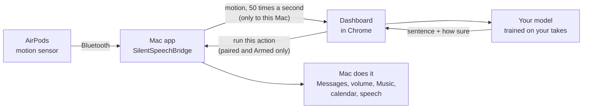

# Silent Speech

**Talk to your Mac without making a sound.**

Wear your AirPods and mouth a sentence with no sound. The motion sensor inside the AirPods feels your jaw move,
a web page works out which sentence it was, and your Mac does it: sends a text, turns the volume up, plays music,
reads your calendar to you.

Real time, no sound from Spiro. <a href="https://youtu.be/UwlPfRa7G9Q">Watch it with sound on YouTube</a> to hear the Mac answer.

## What it does

You get 7 fixed sentences. Each one does a real thing on your Mac.

| Mouth this | Your Mac does this |
|---|---|
| "Text mom I'm on my way" | Texts "On my way!" to the contact you set |
| "Turn the volume up" | Turns the volume up 15% |
| "Call me back later" | Texts "Can't talk now, call me back later" |
| "I created this demo in 48 hours" | Says the sentence out loud (and the page throws confetti) |
| "I need help right now" | Plays an alarm, shows a red alert, and texts "I need help right now" |
| "What's on my calendar today?" | Reads today's events out loud |
| "Play my focus music" | Plays your focus playlist in Apple Music or Spotify |

It also learns what "nothing" looks like (mouth closed and still), so it can tell when you did not say anything.

It is not dictation. It knows these 7 sentences and nothing else, and it has to learn them from your own mouth first.

## Try it now in your browser

No AirPods or Mac needed: **[open the live demo](https://spiro-12.github.io/silent-speech/)**.

- It opens with a **replay of a real session**: Spiro's real AirPods motion, played back, with the model guessing each
  sentence live and marking itself right or wrong.
- Press **Try it yourself with fake data** to get fake AirPods. Pick a sentence at the top, hold <kbd>Space</kbd>, and
  watch it get recognized.

## Why I built this

*By Spiro*

Not everyone can use their voice. Some people lose it for a while after surgery, some lose it to an illness, and
some just can't talk out loud where they are: a quiet office, a library, or next to a sleeping baby. Voice
assistants need you to talk out loud.

So I asked a simple question: **could the AirPods people already own understand a sentence they only mouth, for free?**

AirPods have a motion sensor for head tracking (it is what makes spatial audio follow your head), and Apple lets a Mac
app read it. Research had already shown that the motion sensors in regular earbuds can pick up mouthed words. The
open source AirPods projects I found did head nods or counted chewing, not silent speech.

So I built it over one weekend, with Claude Code. Claude wrote, reviewed and tested the code. I did the parts that
needed a person: wearing the AirPods, mouthing hundreds of sentences, clicking the macOS popups, and checking that my
Mac really did each thing. It works well for me, on one ear, for 7 sentences. That is a first step, not a solution:
it has to learn each person's mouth, and so far only I have tested it. Nobody who has lost their voice has tried
it yet. It is open source so you can try it on your own mouth, see where it breaks, and make it better.

## Quick start

You need a Mac on macOS 14 or newer, AirPods with head tracking (tested on AirPods Pro 3), and Google Chrome.

1. **Get the Mac app.** [Download SilentSpeechBridge](https://github.com/Spiro-12/silent-speech/releases/latest/download/SilentSpeechBridge-macOS.zip),
   unzip it and move it to Applications. It is not signed by Apple, so the first time, open
   **System Settings > Privacy & Security** and click **Open Anyway**.
2. **Put in your AirPods** (one ear is best) and click **Allow** when macOS asks about motion.
3. **Click "Open dashboard"** in the app window. If Chrome asks to let the page reach apps on your Mac, click
   **Allow**. You should see about **50 Hz**.
4. **Record.** Hold <kbd>Space</kbd>, mouth the sentence on screen with no sound, let go. Do every sentence at
   least 5 times (15 is the default).
5. **Recognize, then go live.** Switch to Recognize and check it gets your sentences right. Then click
   **Text contact…** in the app to set who texts go to, and turn on **Armed**. Now your sentences really run.

Every popup and what to click: **[Setup](docs/setup.md)**. Getting it accurate:
**[Train it on your mouth](docs/calibration.md)**. Every screen explained: **[Using it](docs/using.md)**.

## How it works

1. AirPods have a motion sensor for head tracking, and Apple lets a Mac app read it. When you mouth words, your jaw
   moves your head a tiny bit, and the sensor picks that up.
2. The Mac app sends that motion to the dashboard, a web page running on the same Mac.
3. The dashboard compares your take with the takes you recorded (a method called DTW, which lines up two motions
   even if one was faster) and picks the closest sentence, with a score for how sure it is.
4. If it is sure enough and every safety check passes, the dashboard asks the Mac app to do the action.

More detail, for the curious: [docs/how-it-works.md](docs/how-it-works.md).

## How well it works

Honest numbers, from one person (Spiro), with AirPods Pro 3. Guessing at random would be right 1 time in 8.

| Test | Result |
|---|---|
| New session, same ear (trained on his other sessions) | **97.3%** of takes guessed right |
| The two sessions recorded after the settings were tuned | **98.3%** and **97.5%**, 0 wrong actions |
| At the bar texts need (70% sure) | **82.1%** of sentences act on the first try, **0 wrong** out of 420 |
| Live test on the left ear, 16 prompted takes | **16 of 16** right, 13 of 14 sentences acted on the first try, 0 wrong |
| Trained on the left ear, tested on the right ear | about **57% to 69%** (11 of 16 live; 84% only with settings tuned on that same session): the ear matters a lot |

These use two sessions that are not published and live tests on Spiro's Mac, so they cannot be rerun from this repo.
The benchmark you **can** rerun, on the 3 published sessions in [`data/raw/`](data/raw/README.md): **88.2%** with
settings chosen without the test session (94.2% with settings tuned on those same sessions).

Limits: 7 fixed sentences, trained per person and per ear, not free dictation, and not yet tested on other people.
Full numbers and how they were measured: [docs/results.md](docs/results.md).

## Safety and privacy

- **Everything stays on your Mac.** Motion goes from the Mac app to the dashboard tab on the same Mac, nowhere else.
  Your recordings stay in your browser unless you export them.
- **Nothing runs until you say so.** The Mac app starts with **Armed** off, and only you can turn it on, in the app.
  Texts only go to the one contact you set, need the model to be 70% sure, and have a 30 second cooldown.
- **Only your dashboard can ask.** The page must be opened from the Mac app's own link (it carries a secret pairing
  code), and the app only listens on this Mac and only to the dashboard's web address.

Details: [docs/safety-privacy.md](docs/safety-privacy.md).

## FAQ

<b>Does it use the microphone?</b>

No. Only the AirPods' motion sensor. No sound is recorded or sent anywhere, and you mouth the words with no sound.

<b>Which AirPods work?</b>

AirPods with head tracking. Tested on AirPods Pro 3 (about 50 readings a second). AirPods Pro, AirPods Pro 2, AirPods
Max and AirPods (3rd generation) or newer should work, but nobody has tested them with this yet. Older models may send
only about 25 readings a second (reported in papers, not tested here). If you try one, please [tell us how it went](https://github.com/Spiro-12/silent-speech/issues/new/choose).

<b>Is anything sent to a server?</b>

No, apart from the texts you set up, which Messages sends like any iMessage. The dashboard is a static web page on GitHub Pages: no server behind it, no account, no analytics. Motion goes from
the Mac app to that page on your own Mac. Your takes stay in your browser's storage for the site unless you export
them. One thing to know: browsers share storage per site, so any page on `spiro-12.github.io` could read those takes.
That is also why the pairing code is never stored there.

<b>Will it text someone by accident?</b>

It is built hard against that. Armed is off at every launch and only you can turn it on. The page must be paired with
the app. A text needs your own complete model to be at least 70% sure. Texts only go to the one contact you set, each
texting sentence has a 30 second cooldown, and nothing is ever retried. On Spiro's data, no wrong action ran at the 70%
bar, but that is one person: start with your own number. See [Safety and privacy](docs/safety-privacy.md).

<b>Does it work for other people?</b>

Everyone trains their own model on their own mouth. So far it has only been tested on one person (Spiro), so we do not
know yet how well it works for others. Your results will differ.

More questions (Macs, Chrome, signing, Simulate motion): **[the full FAQ](docs/faq.md)**.

## Contributing

- **No coding needed:** [share your recordings](https://github.com/Spiro-12/silent-speech/issues/new?template=share_recordings.yml)
  so we can see if it works for more people, or tell us how it went on your AirPods.
- **Code:** start with a [good first issue](https://github.com/Spiro-12/silent-speech/labels/good%20first%20issue).
  Dev setup, tests and the project layout: [CONTRIBUTING.md](CONTRIBUTING.md).
- **Ideas:** [what could come next](docs/ideas.md), or [suggest one](https://github.com/Spiro-12/silent-speech/issues/new/choose).

## Docs

| Guide | What is in it |
|---|---|
| [Setup](docs/setup.md) | Install, permissions, first recording, step by step |
| [Using it](docs/using.md) | Every screen: Record, Recognize, Armed, the demo screen, tips |
| [Train it on your mouth](docs/calibration.md) | How to record so it works well |
| [Make it yours](docs/make-it-yours.md) | Your contact, your music, the demo screen, changing sentences |
| [How it works](docs/how-it-works.md) | The sensor, the math, the safety rule |
| [Results](docs/results.md) | Every number, and how it was measured |
| [Safety and privacy](docs/safety-privacy.md) | What stays where, and what can run when |
| [Troubleshooting](docs/troubleshooting.md) | When something does not work |
| [FAQ](docs/faq.md) | Mic, AirPods models, Macs, Chrome, privacy, signing |
| [Contributing](CONTRIBUTING.md) | Dev setup, tests, pull requests |

## Credits and inspiration

- Built by Spiro El Khoury over one weekend, with Claude Code as the coding partner.
- Inspired by silent speech research: SwanTrumpet (IMWUT 2025) read words from the motion sensors of regular earbuds,
  and MuteIt (UbiComp 2022), Unvoiced (SenSys 2024), EchoSpeech (CHI 2023), LipLearner (CHI 2023) and MIT's AlterEgo
  showed silent commands from the jaw, face and lips. Notes: [docs/dev/RESEARCH.md](docs/dev/RESEARCH.md).
- The "luck test" in the benchmark is an idea from [joeblau/subvox](https://github.com/joeblau/subvox).

## License

[MIT](LICENSE). Spiro's recordings in [`data/raw/`](data/raw/README.md) are published with his OK.
