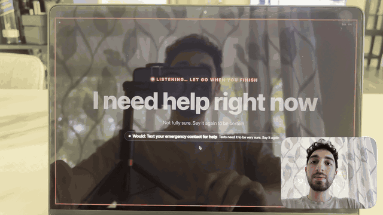
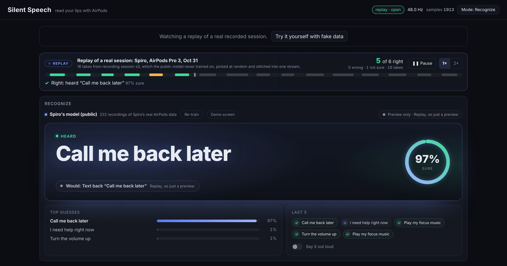
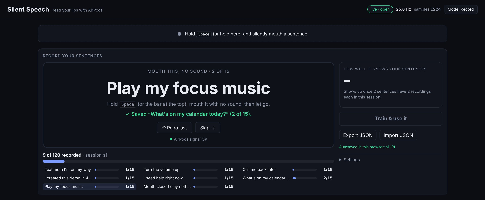
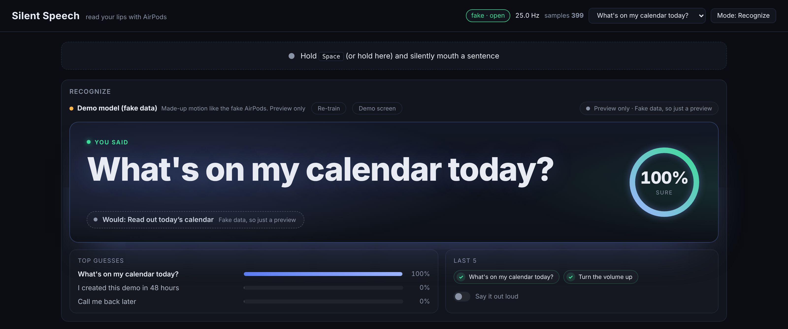
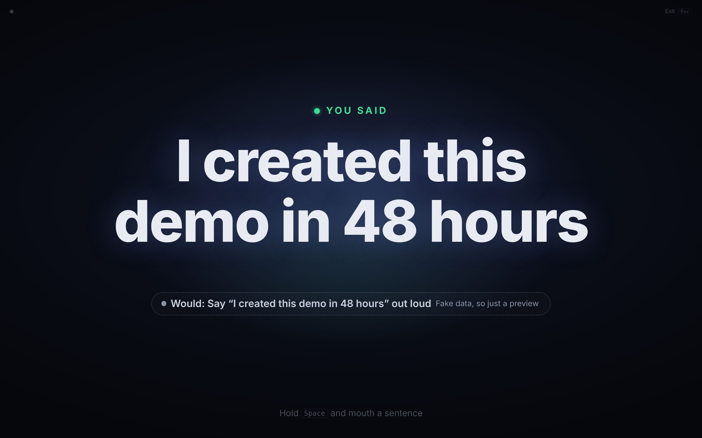
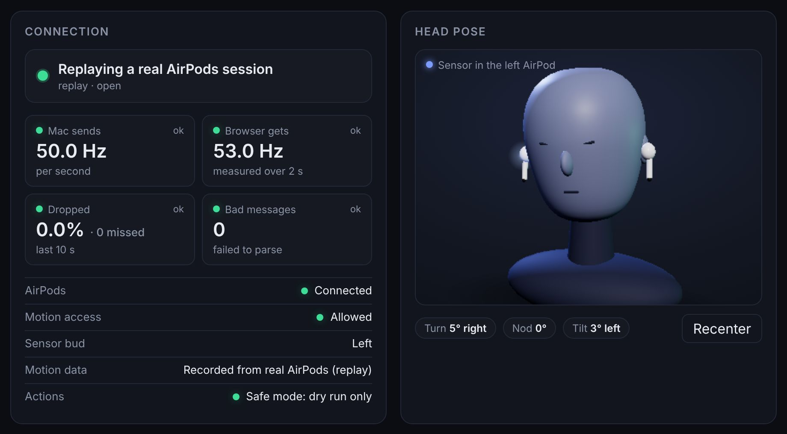
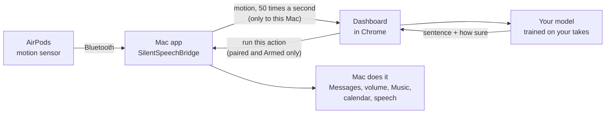

# Silent Speech

**Talk to your Mac without making a sound.**

Wear your AirPods and mouth a sentence with no sound. The motion sensor inside the AirPods feels your jaw move,
a web page works out which sentence it was, and your Mac does it: sends a text, turns the volume up, plays music,
reads your calendar to you.

[](https://spiro-12.github.io/silent-speech/)
[](https://github.com/Spiro-12/silent-speech/actions/workflows/ci.yml)
[](LICENSE)


[](https://youtu.be/UwlPfRa7G9Q)

<sub>Watch the demo video on YouTube (click the picture).</sub>

<!--
  DEMO GIF SLOT (not made yet).
  When docs/images/demo.gif exists, put it here, above the video link:
  <p align="center"></p>
-->



<sub>The live site replaying one of Spiro's real recording sessions. The model never saw this session while it was trained.</sub>

## Contents

- [What it does](#what-it-does) · [Why I built this](#why-i-built-this) ·
  [Try it now in your browser](#try-it-now-in-your-browser) · [Screenshot tour](#screenshot-tour)
- [What you need](#what-you-need) · [Set it up](#set-it-up) · [Using it](#using-it) ·
  [Tips for accuracy](#tips-for-accuracy)
- [How it works](#how-it-works) · [How well it works](#how-well-it-works) · [Safety and privacy](#safety-and-privacy)
- [FAQ](#faq) · [Ideas for later](#ideas-for-later) · [Project layout](#project-layout) ·
  [Development](#development) · [Docs](#docs) · [Credits and inspiration](#credits-and-inspiration) ·
  [License](#license)

## What it does

You get 7 fixed sentences. Each one does a real thing on your Mac.

| Mouth this | Your Mac does this |
|---|---|
| "Text mom I'm on my way" | Texts "On my way!" to the contact you set |
| "Turn the volume up" | Turns the volume up 15% |
| "Call me back later" | Texts "Can't talk now, call me back later" |
| "I created this demo in 48 hours" | Says the sentence out loud (and the page throws confetti) |
| "I need help right now" | Plays an alarm, shows a red alert, and texts "I need help right now" |
| "What's on my calendar today?" | Reads today's events out loud |
| "Play my focus music" | Plays your focus playlist in Apple Music or Spotify |

It also learns what "nothing" looks like (mouth closed and still), so it can tell when you did not say anything.

It is not dictation. It knows these 7 sentences and nothing else, and it has to learn them from your own mouth first.

## Why I built this

*By Spiro*

A Y Combinator startup is building silent speech into a pair of glasses: you mouth words, the glasses understand.
I liked the idea, but it means buying new hardware. So I asked a simpler question: **could the AirPods people already
own do some of this, for free?**

AirPods have a motion sensor for head tracking (it is what makes spatial audio follow your head), and Apple lets a Mac
app read it. Research had already shown that the motion sensors in regular earbuds can pick up mouthed words. The
open source AirPods projects I found did head nods or counted chewing, not silent speech.

So I built it over one weekend, with Claude Code. Claude wrote, reviewed and tested the code. I did the parts that
needed a person: wearing the AirPods, mouthing hundreds of sentences, clicking the macOS popups, and checking that my
Mac really did each thing. It works well for me, on one ear, for 7 sentences. It is open source so you can try it on
your own mouth, see where it breaks, and make it better.

## Try it now in your browser

No AirPods or Mac needed: **[open the live demo](https://spiro-12.github.io/silent-speech/)**.

- It opens with a **replay of a real session**: Spiro's real AirPods motion, played back, with the model guessing each
  sentence live and marking itself right or wrong.
- Press **Try it yourself with fake data** to get fake AirPods. Pick a sentence at the top, hold <kbd>Space</kbd>, and
  watch it get recognized.

## Screenshot tour

The replay at the top of this page is what visitors see first. The other screens:

<table>
  <tr>
    <td width="50%" valign="top">
      
      <br><b>Record.</b> One sentence at a time. Hold Space, mouth it, let go. Progress for every sentence below.
    </td>
    <td width="50%" valign="top">
      
      <br><b>Recognize.</b> What it heard, how sure it is, and what your Mac would do (shown here with fake data).
    </td>
  </tr>
  <tr>
    <td width="50%" valign="top">
      
      <br><b>Demo screen.</b> Full screen, only the sentence, for filming. Texts never send from it.
    </td>
    <td width="50%" valign="top">
      
      <br><b>Connection and head pose.</b> Readings per second, dropped samples, and which AirPod is the sensor.
    </td>
  </tr>
</table>

## What you need

| You need | Details |
|---|---|
| **Mac** | macOS 14 (Sonoma) or newer. Apple silicon or Intel. |
| **AirPods** | AirPods with head tracking. Tested on **AirPods Pro 3**. AirPods Pro, AirPods Pro 2, AirPods Max and AirPods (3rd generation) or newer should work too, but have not been tested yet. |
| **Browser** | **Google Chrome** (recommended; see the [FAQ](#faq)). |
| **For the texting sentences** | Messages on the Mac, signed in to iMessage. |
| **Time** | About 10 minutes to record your sentences once, more for a second session. |

## Set it up

About 20 minutes, most of it recording. This is the short version; **[docs/setup.md](docs/setup.md)** has every popup
and what to click.

**1. Get the Mac app.**
[Download SilentSpeechBridge-macOS.zip](https://github.com/Spiro-12/silent-speech/releases/latest/download/SilentSpeechBridge-macOS.zip),
double click it to unzip, and drag **SilentSpeechBridge** into Applications. (Or
[build it from source](docs/setup.md#option-b-build-it-from-source) with Apple's free Command Line Tools; no Xcode.)

**2. Open it the first time.** The app is not signed by Apple, so macOS blocks it once. Click **Done**, open
**System Settings > Privacy & Security**, scroll to **Security**, click **Open Anyway** next to SilentSpeechBridge and
type your Mac password. After that it opens normally.

**3. Follow the app's Get started box.** The app window has a **Get started** box with three steps, each with a dot
that turns green when done:
- **Put in your AirPods.** Make sure they are connected to this Mac and are its sound output (Control Center > Sound).
  Tip: wear **one** AirPod, so you always know which one is the sensor.
- **Allow Motion access when macOS asks.** Click **Allow**.
- **Click Open dashboard.** It opens the dashboard in your browser, paired with the app. Make Chrome your default
  browser first (System Settings > Desktop & Dock), so it opens there.

**4. Let Chrome reach the app.** The first time, Chrome asks to let the page access other apps and services on this
device. Click **Allow**. The page's **Connection** card should then say **Streaming from AirPods**, at about
**50 Hz** (50 readings a second), and the head picture should say which AirPod is the sensor.

**5. Record your sentences.** The page starts in Record mode. See [Using it](#using-it) below. Do every sentence at
least 5 times; 15 is the default.

**6. Recognize.** Click **Mode: Record** at the top right to switch to Recognize. The Recognize card trains on your
takes and should say **Your model: N recordings**. Mouth a sentence and check it gets them right.

**7. Set your contact and music.** In the app window's **Settings** box:
- **Text contact…**: type a mobile number with + and the country code, click **Next**, then **Yes, save**. All three
  texting sentences go to this one number. Use your own number first.
- **Focus music…**: a playlist name from your Music library, an Apple Music link, or a Spotify link.

**8. Turn on Armed.** In the app's Settings box, switch on **Armed (let actions really run)**. The dashboard now says
**Live: sentences run on your Mac**. The first text, music and calendar action each bring one macOS popup (control
Messages, control Music, full calendar access): click **OK** or **Allow**.

Next time: open the app, put in your AirPods (same ear), click **Open dashboard**, switch to Recognize, turn on Armed.
Quit with **Cmd+Q** when you are done, because the app keeps the Mac awake while it runs.

## Using it

### Record

- The page shows one sentence. Wait until it turns solid white, hold <kbd>Space</kbd> (or the bar at the top), mouth
  it with no sound, then let go. Made a mistake? **Redo last**.
- Sentences come in a shuffled order. The default is **15 takes of each** per session. Your model can run actions once
  every sentence has **at least 5**.
- **"Mouth closed (say nothing)"** is the 8th thing it learns: keep your mouth closed and still while you hold Space.
  No nods, no swallows.
- A **session** is one sitting. When one is done, take the AirPods out and back in and press
  **Start the next session**. More sessions, at different times, make it much better.
- **How well it knows your sentences** (right side) tests itself on your takes as you go, with a small grid of which
  sentences it mixes up.
- Takes are saved in this browser. **Export JSON** after each session as a backup; **Import JSON** brings one back.

### Recognize

- Switch with the **Mode** button at the top right. The model line says what it is using: **Your model** (the only
  one that can run actions), a preview of yours (not every sentence has 5 takes yet), or Spiro's public model.
- Hold <kbd>Space</kbd>, mouth a sentence, let go. The ring shows how sure it is:

  | Shows | When | What may run |
  |---|---|---|
  | **You said** | 70% sure or more, and the model accepts it | Any action, texts included |
  | **Probably** | 50% to 70% | Only harmless ones: volume, music, calendar, the demo line |
  | **Not sure, try again** | Under 50% | Nothing |

- Under the sentence, a chip says what happened, or **Would: …** and the reason it did not run (for example
  "Safe mode: turn on Armed in the Mac app").
- Recorded more takes? Press **Re-train** (the model line says so when it is out of date).
- **Say it out loud** makes the browser speak each sentence it is sure about.

### Armed: what each sentence does

Nothing real happens until you turn on **Armed** in the Mac app. It is off every time the app starts. Then:

| Sentence | What happens on your Mac |
|---|---|
| Text mom I'm on my way | Messages sends "On my way!" to your contact |
| Turn the volume up | Volume up 15% (up to 100%), and unmute |
| Call me back later | Messages sends "Can't talk now, call me back later" to your contact |
| I created this demo in 48 hours | The Mac says the sentence out loud (you can change the words) |
| I need help right now | Alarm sound, a red notice above every window, the Dock icon bounces, and a text "I need help right now" to your contact. It never calls emergency services |
| What's on my calendar today? | Reads today's events and speaks one sentence about them (written by Apple's on device model on macOS 26 with Apple Intelligence, otherwise a plain list) |
| Play my focus music | Your playlist in Music, an Apple Music link, or Spotify. With nothing set: Apple Music's public "Pure Focus" playlist |

Texts have a 30 second cooldown each; other actions 3 seconds. Change the messages, the spoken line and the volume step
in [Make it yours](docs/make-it-yours.md).

### Demo screen

For filming. On the Recognize card, click **Demo screen**: the page goes full screen and shows only the sentence.
Press <kbd>Esc</kbd> to leave.

- **Texts never send from it.** When a text would have gone out, it shows a text bubble marked **Demo: not sent**.
- **"I need help right now"** sounds a short alarm and says **Demo: no text sent**, but only when a real help text would
  have gone out (live, Armed, paired, your own model, every check passed). Otherwise the red alert shows the usual
  **Would: …** line, with no sound.
- **Harmless actions still run** on the Mac (volume, music, calendar, the demo line).
- **It speaks every sentence it shows**, from 50% sure ("Probably" too), so the video has sound. (Not the demo line
  when the Mac is already saying it.)

### Session recorder

With the Mac app connected, the **Session recorder** card records a whole run: motion, your push to talk, what the
model heard and what ran. It prompts you with the sentence to say next, so every take is scored, and exports a replay
file like the one on the live site. It is also a good way to test yourself on sentences you did not pick.

## Tips for accuracy

The short version of [Train it on your mouth](docs/calibration.md):

- **One ear.** Wear one AirPod, or check which one is the sensor. Record and use the same ear.
- **Still "nothing".** For "Mouth closed", keep your mouth closed and still. No nods, no swallows.
- **Clear mouthing.** A bit bigger than normal, the same way every time, head still (rest it against a chair).
- **Generous timing.** Press Space a moment before you start and let go a moment after you finish.
- **Two or more sessions,** at different times. On Spiro's data, one session predicted the next at 92%; four sessions
  at 98.3%.
- **Re-train** after recording more.

## How it works



1. AirPods have a motion sensor for head tracking, and Apple lets a Mac app read it. When you mouth words, your jaw
   moves your head a tiny bit, and the sensor picks that up.
2. The Mac app sends that motion to the dashboard, a web page running on the same Mac.
3. The dashboard compares your take with the takes you recorded (a method called DTW, which lines up two motions
   even if one was faster) and picks the closest sentence, with a score for how sure it is.
4. If it is sure enough and every safety check passes, the dashboard asks the Mac app to do the action.

More detail, for the curious: [docs/how-it-works.md](docs/how-it-works.md).

## How well it works

Honest numbers, from one person (Spiro), with AirPods Pro 3. Guessing at random would be right 1 time in 8.

| Test | Result |
|---|---|
| New session, same ear (trained on his other sessions) | **97.3%** of takes guessed right |
| The two sessions recorded after the settings were tuned | **98.3%** and **97.5%**, 0 wrong actions |
| At the bar texts need (70% sure) | **82.1%** of sentences act on the first try, **0 wrong** out of 420 |
| Live test on the left ear, 16 prompted takes | **16 of 16** right, 13 of 14 sentences acted on the first try, 0 wrong |
| Trained on the left ear, tested on the right ear | about **57% to 69%** (11 of 16 live; 84% only with settings tuned on that same session): the ear matters a lot |

These use two sessions that are not published and live tests on Spiro's Mac, so they cannot be rerun from this repo.
The benchmark you **can** rerun, on the 3 published sessions in [`data/raw/`](data/raw/README.md): **88.2%** with
settings chosen without the test session (94.2% with settings tuned on those same sessions).

Limits: 7 fixed sentences, trained per person and per ear, not free dictation, and not yet tested on other people.
Full numbers and how they were measured: [docs/results.md](docs/results.md).

## Safety and privacy

- **Everything stays on your Mac.** Motion goes from the Mac app to the dashboard tab on the same Mac, nowhere else.
  Your recordings stay in your browser unless you export them.
- **Nothing runs until you say so.** The Mac app starts with **Armed** off, and only you can turn it on, in the app.
  Texts only go to the one contact you set, need the model to be 70% sure, and have a 30 second cooldown.
- **Only your dashboard can ask.** The page must be opened from the Mac app's own link (it carries a secret pairing
  code), and the app only listens on this Mac and only to the dashboard's web address.

Details: [docs/safety-privacy.md](docs/safety-privacy.md).

## FAQ

**Does it use the microphone?**
No. Only the AirPods' motion sensor. No sound is recorded or sent anywhere, and you mouth the words with no sound.

**Which AirPods work?**
AirPods with head tracking. Tested on AirPods Pro 3 (about 50 readings a second). AirPods Pro, AirPods Pro 2, AirPods
Max and AirPods (3rd generation) or newer should work, but nobody has tested them with this yet. Older models send
about 25 readings a second. If you try one, please [tell us how it went](https://github.com/Spiro-12/silent-speech/issues/new/choose).

**Which Macs work?**
Any Mac with macOS 14 (Sonoma) or newer, Apple silicon or Intel. The friendly calendar summary needs macOS 26 with
Apple Intelligence on; otherwise the Mac reads a plain list.

**Why Chrome?**
The dashboard is a secure (https) web page that talks to the Mac app at a local address (`ws://127.0.0.1:8765`).
Chrome allows that after you click Allow once. Other browsers may block it. Chrome is the one we tested.

**Is anything sent to a server?**
No. The dashboard is a static web page on GitHub Pages: no server behind it, no account, no analytics. Motion goes from
the Mac app to that page on your own Mac. Your takes stay in your browser's storage for the site unless you export
them. One thing to know: browsers share storage per site, so any page on `spiro-12.github.io` could read those takes.
That is also why the pairing code is never stored there.

**Why is the Mac app not signed by Apple?**
Signing and notarizing need a paid Apple developer account. So macOS asks you once to confirm (**Open Anyway**). You
can read every line of the app's code in [`mac/`](mac/), check the download against the SHA-256 on the release page,
or [build it yourself](docs/setup.md#option-b-build-it-from-source).

**Can it learn any sentence, or do dictation?**
No. It knows 7 fixed sentences plus "nothing", and it picks the closest one. It cannot type what you say. A fork can
change the sentences, but that means changing the code and recording again:
[Make it yours](docs/make-it-yours.md#change-the-sentences-fork).

**Does it work for other people?**
Everyone trains their own model on their own mouth. So far it has only been tested on one person (Spiro), so we do not
know yet how well it works for others. Your results will differ.

**Will it text someone by accident?**
It is built hard against that. Armed is off at every launch and only you can turn it on. The page must be paired with
the app. A text needs your own complete model to be at least 70% sure. Texts only go to the one contact you set, each
texting sentence has a 30 second cooldown, and nothing is ever retried. On Spiro's data, no wrong action ran at the 70%
bar, but that is one person: start with your own number. See [Safety and privacy](docs/safety-privacy.md).

**What does Simulate motion do?**
It makes the Mac app send fake motion (smooth waves, 50 a second) instead of the AirPods' readings, so you can check
the app and the dashboard talk to each other without AirPods. Simulated motion is never saved as real training data
and never runs actions.

**Does it keep my Mac awake?**
Yes, while it runs, so the motion keeps flowing. Quit it with **Cmd+Q**. Closing the window does not quit it.

**Something does not work.**
See [Troubleshooting](docs/troubleshooting.md), then [open an issue](https://github.com/Spiro-12/silent-speech/issues/new/choose).

## Ideas for later

Ideas, not promises:

- **Test it on more people**, and publish how well it works for them.
- **Both ears**: work well whichever AirPod macOS picks, without recording each ear.
- **Your own sentences** chosen in the dashboard, instead of changing the code.
- **More actions**, like reading a message back or starting a timer.
- **No push to talk**: notice on its own when you start mouthing.
- **An iPhone or Apple Watch version**, so it works away from the Mac.
- **Better models**, tried on more data (the benchmark already compares DTW with MiniRocket and a small neural
  network).

Have an idea? [Open a feature request](https://github.com/Spiro-12/silent-speech/issues/new/choose).

## Project layout

| Folder | What is in it |
|---|---|
| [`web/`](web/) | The dashboard: Vite and plain TypeScript. Panels, data sources, and the DTW + kNN model in `web/src/ml/`. |
| [`mac/`](mac/) | SilentSpeechBridge, the Mac app (Swift and SwiftUI), its build script and setup scripts. |
| [`ml/`](ml/) | The Python benchmark: the same DTW + kNN, plus MiniRocket and a 1D CNN. Report in [`ml/RESULTS.md`](ml/RESULTS.md). |
| [`data/`](data/) | Spiro's published recordings ([`data/raw/`](data/raw/README.md)) and the first early test. |
| [`shared/`](shared/) | The sentences ([`shared/classes.json`](shared/classes.json)) and test fixtures, used by both the web and Python code. |
| [`docs/`](docs/) | The guides, screenshots, and [`docs/dev/`](docs/dev/README.md) (the protocol and how it was built). |
| [`scripts/`](scripts/) | Command line tools: evaluate the model, export the public model, build the replay, make test data. |
| [`tests/`](tests/) | Unit tests (Vitest), browser tests (Playwright) and a mock Mac app for testing without a Mac. |

## Development

You need Node.js 22. Full guide: [CONTRIBUTING.md](CONTRIBUTING.md).

```bash
npm ci
npm run dev                  # the dashboard at http://localhost:5173/silent-speech/ (add ?mode=fake for fake AirPods)
npm run bridge -- --allow-origin http://localhost:5173   # a mock Mac app at ws://127.0.0.1:18765
#   then open http://localhost:5173/silent-speech/?mode=live&ws=ws://127.0.0.1:18765
npm run typecheck && npm test && npx playwright test     # types, unit tests, browser tests
```

- Browser tests take their ports from `E2E_WEB_PORT` and `E2E_MOCK_PORT`. **Never use port 8765 in tests**: that is
  the real Mac app, and it can send real texts.
- The Mac app builds with `cd mac && ./build.sh` (Command Line Tools only). The Python benchmark runs with
  `cd ml && uv sync && uv run pytest -q`.
- The contracts between the Mac app, the dashboard and the model are in [docs/dev/PROTOCOL.md](docs/dev/PROTOCOL.md).

## Docs

| Guide | What is in it |
|---|---|
| [Setup](docs/setup.md) | Install, permissions, first recording, step by step |
| [Train it on your mouth](docs/calibration.md) | How to record so it works well |
| [Make it yours](docs/make-it-yours.md) | Your contact, your music, the demo screen, changing sentences |
| [How it works](docs/how-it-works.md) | The sensor, the math, the safety rule |
| [Results](docs/results.md) | Every number, and how it was measured |
| [Safety and privacy](docs/safety-privacy.md) | What stays where, and what can run when |
| [Troubleshooting](docs/troubleshooting.md) | When something does not work |
| [Contributing](CONTRIBUTING.md) | Dev setup, tests, pull requests |

## Credits and inspiration

- Built by Spiro El Khoury over one weekend, with Claude Code as the coding partner.
- Inspired by silent speech research: SwanTrumpet (IMWUT 2025) read words from the motion sensors of regular earbuds,
  and MuteIt (UbiComp 2022), Unvoiced (SenSys 2024), EchoSpeech (CHI 2023), LipLearner (CHI 2023) and MIT's AlterEgo
  showed silent commands from the jaw, face and lips. Notes: [docs/dev/RESEARCH.md](docs/dev/RESEARCH.md).
- A Y Combinator startup is building silent speech into glasses. This project asks how far the AirPods you already
  own can get, for free.
- The "luck test" in the benchmark is an idea from [joeblau/subvox](https://github.com/joeblau/subvox).

## License

[MIT](LICENSE). Spiro's recordings in [`data/raw/`](data/raw/README.md) are published with his OK.
