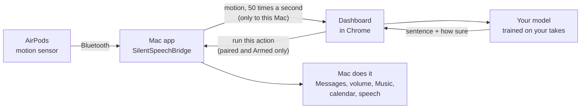

# Silent Speech

**Talk to your Mac without making a sound.**

Wear your AirPods and mouth a sentence with no sound. The motion sensor inside the AirPods feels your jaw move,
a web page works out which sentence it was, and your Mac does it: sends a text, turns the volume up, plays music,
reads your calendar to you.

Watch the demo video on YouTube (click the picture).

<!--
  DEMO GIF SLOT (not made yet).
  When docs/images/demo.gif exists, put it here, above the video link:
  

-->

The live site replaying one of Spiro's real recording sessions. The model never saw this session while it was trained.

## What it does

You get 7 fixed sentences. Each one does a real thing on your Mac.

| Mouth this | Your Mac does this |
|---|---|
| "Text mom I'm on my way" | Texts "On my way!" to the contact you set |
| "Turn the volume up" | Turns the volume up 15% |
| "Call me back later" | Texts "Can't talk now, call me back later" |
| "I created this demo in 48 hours" | Says the sentence out loud (and the page throws confetti) |
| "I need help right now" | Plays an alarm, shows a red alert, and texts "I need help right now" |
| "What's on my calendar today?" | Reads today's events out loud |
| "Play my focus music" | Plays your focus playlist in Apple Music or Spotify |

It also learns what "nothing" looks like (mouth closed and still), so it can tell when you did not say anything.

It is not dictation. It knows these 7 sentences and nothing else, and it has to learn them from your own mouth first.

## Try it now in your browser

No AirPods or Mac needed: **[open the live demo](https://spiro-12.github.io/silent-speech/)**.

- It opens with a **replay of a real session**: Spiro's real AirPods motion, played back, with the model guessing each
  sentence live and marking itself right or wrong.
- Press **Try it yourself with fake data** to get fake AirPods. Pick a sentence at the top, hold <kbd>Space</kbd>, and
  watch it get recognized.

## What you need

- A **Mac** with **macOS 14** (Sonoma) or newer.
- **AirPods with head tracking**: tested on AirPods Pro 3. AirPods Pro, AirPods Pro 2, AirPods Max and AirPods
  (3rd generation) or newer should work too.
- **Google Chrome** (recommended).
- About 10 minutes to record your sentences.

## Quick start

1. **Get the Mac app.** [Download SilentSpeechBridge](https://github.com/Spiro-12/silent-speech/releases/latest/download/SilentSpeechBridge-macOS.zip),
   unzip it and move it to Applications. It is not signed by Apple, so the first time you open it, go to
   System Settings > Privacy & Security and click **Open Anyway**.
2. **Put in your AirPods** and click **Allow** when macOS asks about motion.
3. **Click "Open dashboard"** in the app window. If Chrome asks to let the page reach apps on your Mac, click **Allow**.
4. **Record.** The page shows one sentence at a time. Hold <kbd>Space</kbd>, mouth it with no sound, let go.
   Do every sentence at least 5 times (15 is the default).
5. **Recognize.** Switch the page to Recognize mode and mouth a sentence. When it gets them right, click
   **Text contact…** in the Mac app to set who your texts go to, then turn on **Armed**. Now your sentences really run.

The full guide, with every popup and what to click: **[docs/setup.md](docs/setup.md)**.

## How it works

1. AirPods have a motion sensor for head tracking, and Apple lets a Mac app read it. When you mouth words, your jaw
   moves your head a tiny bit, and the sensor picks that up.
2. The Mac app sends that motion to the dashboard, a web page running on the same Mac.
3. The dashboard compares your take with the takes you recorded (a method called DTW, which lines up two motions
   even if one was faster) and picks the closest sentence, with a score for how sure it is.
4. If it is sure enough and every safety check passes, the dashboard asks the Mac app to do the action.

More detail, for the curious: [docs/how-it-works.md](docs/how-it-works.md).

## How well it works

Honest numbers, from one person (Spiro), with AirPods Pro 3. Guessing at random would be right 1 time in 8.

| Test | Result |
|---|---|
| New session, same ear (trained on his other sessions) | **97.3%** of takes guessed right |
| The two sessions recorded after the settings were tuned | **98.3%** and **97.5%**, 0 wrong actions |
| At the bar texts need (70% sure) | **82.1%** of sentences act on the first try, **0 wrong** out of 420 |
| Live test on the left ear, 16 prompted takes | **16 of 16** right, 13 of 14 sentences acted on the first try, 0 wrong |
| Trained on the left ear, tested on the right ear | about **57% to 69%** (11 of 16 live; 84% only with settings tuned on that same session): the ear matters a lot |

These use two sessions that are not published and live tests on Spiro's Mac, so they cannot be rerun from this repo.
The benchmark you **can** rerun, on the 3 published sessions in [`data/raw/`](data/raw/README.md): **88.2%** with
settings chosen without the test session (94.2% with settings tuned on those same sessions).

Limits: 7 fixed sentences, trained per person and per ear, not free dictation, and not yet tested on other people.
Full numbers and how they were measured: [docs/results.md](docs/results.md).

## Safety and privacy

- **Everything stays on your Mac.** Motion goes from the Mac app to the dashboard tab on the same Mac, nowhere else.
  Your recordings stay in your browser unless you export them.
- **Nothing runs until you say so.** The Mac app starts with **Armed** off, and only you can turn it on, in the app.
  Texts only go to the one contact you set, need the model to be 70% sure, and have a 30 second cooldown.
- **Only your dashboard can ask.** The page must be opened from the Mac app's own link (it carries a secret pairing
  code), and the app only listens on this Mac and only to the dashboard's web address.

Details: [docs/safety-privacy.md](docs/safety-privacy.md).

## Docs

| Guide | What is in it |
|---|---|
| [Setup](docs/setup.md) | Install, permissions, first recording, step by step |
| [Train it on your mouth](docs/calibration.md) | How to record so it works well |
| [Make it yours](docs/make-it-yours.md) | Your contact, your music, the demo screen, changing sentences |
| [How it works](docs/how-it-works.md) | The sensor, the math, the safety rule |
| [Results](docs/results.md) | Every number, and how it was measured |
| [Safety and privacy](docs/safety-privacy.md) | What stays where, and what can run when |
| [Troubleshooting](docs/troubleshooting.md) | When something does not work |
| [Contributing](CONTRIBUTING.md) | Dev setup, tests, pull requests |

## Credits and inspiration

- Built by Spiro El Khoury over one weekend, with Claude Code as the coding partner.
- Inspired by silent speech research: SwanTrumpet (IMWUT 2025) read words from the motion sensors of regular earbuds,
  and MuteIt (UbiComp 2022), Unvoiced (SenSys 2024), EchoSpeech (CHI 2023), LipLearner (CHI 2023) and MIT's AlterEgo
  showed silent commands from the jaw, face and lips. Notes: [docs/dev/RESEARCH.md](docs/dev/RESEARCH.md).
- A Y Combinator startup is building silent speech into glasses. This project asks how far the AirPods you already
  own can get, for free.
- The "luck test" in the benchmark is an idea from [joeblau/subvox](https://github.com/joeblau/subvox).

## License

[MIT](LICENSE). Spiro's recordings in [`data/raw/`](data/raw/README.md) are published with his OK.
