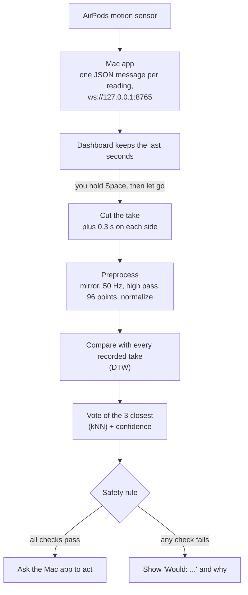

# How it works

For the curious. This page explains the sensor, the pipeline, the model and the safety rule. The exact contracts (the
WebSocket messages, file formats and the preprocessing spec that JavaScript and Python both follow) are in
[docs/dev/PROTOCOL.md](dev/PROTOCOL.md).

**Contents:** [The sensor](#the-sensor) ·
[The pipeline](#the-pipeline) ·
[Preprocessing](#preprocessing) ·
[DTW and kNN](#dtw-and-knn) ·
[How sure is it?](#how-sure-is-it) ·
[The bud mirror](#the-bud-mirror) ·
[Why you train your own](#why-you-train-your-own) ·
[Why DTW](#why-dtw) ·
[The safety rule](#the-safety-rule) ·
[Run the numbers yourself](#run-the-numbers-yourself)

## The sensor

AirPods with head tracking have a motion sensor (an IMU: an accelerometer plus a gyroscope) for spatial audio. Apple
lets native apps read it with `CMHeadphoneMotionManager` (iOS 14+, macOS 14+). There is no way to read it from a web
page, which is why there is a Mac app.

Each reading has:

| Field | What it is | Used? |
|---|---|---|
| `q` | head orientation (a quaternion) | for the 3D head only |
| `rr` | rotation rate, 3 axes, radians per second | yes |
| `ua` | user acceleration (gravity removed), 3 axes, in g | yes |
| `g` | gravity direction | no |

Only one AirPod sends motion at a time, and macOS picks which. The rate cannot be set: AirPods Pro 3 send about
**50 readings a second** (we measured 50 Hz with steady 20 ms steps); papers measured about 25 Hz on older AirPods.

What it does **not** give you: the bone conduction "voice" sensor and the in ear microphone are firmware only, with no
API. So this project never uses sound at all.

**What can it feel?** When you mouth a syllable your jaw opens and closes, about 4 to 8 times a second, and that
nudges your head. Sampling at 25 to 50 Hz catches that rhythm easily. Lips and tongue barely move the head, so they
are mostly invisible. That is why it recognizes **whole sentences** (their rhythm and jaw pattern), not words or
letters, and why sentences with different syllable counts are the easiest to tell apart.

The first real test (before any of this code, using an iPhone logging app) showed mouthing at about **8 to 14 times**
the motion energy of sitting still, in the jaw's frequency band. Notes: [docs/dev/RESEARCH.md](dev/RESEARCH.md).

## The pipeline



Push to talk does the cutting: there is no automatic "did you just say something?" detection yet. Your takes, the
model and the decision all live in the browser tab. The Mac app only streams motion and runs actions.

## Preprocessing

The same steps run in JavaScript (`web/src/ml/preprocess.ts`) and Python (`ml/silent/preprocess.py`), and tests check
they agree with SciPy to 6 decimal places.

0. **Mirror** a right AirPod's take into the left AirPod's frame (see [The bud mirror](#the-bud-mirror)).
1. **Even timing.** Readings arrive with jitter. Put them on an exact 50 Hz grid by linear interpolation.
2. **Pick 6 channels:** rotation rate x, y, z and acceleration x, y, z.
3. **High pass at 1 Hz** (a 2nd order Butterworth filter, run forward and backward so nothing shifts in time). This
   removes slow head drift and keeps the faster jaw rhythm.
4. **Stretch to 96 points.** Every take becomes the same length, whatever its duration.
5. **Normalize each take on its own** (each channel to mean 0 and spread 1). Sessions differ a lot in loudness (in
   Spiro's data one session's rotation was twice as strong as another's), and this cancels it. It was worth about
   +6 to +9 points on real data. Very quiet takes are not blown up: the spread has a floor of half the typical spread.

## DTW and kNN

**DTW** (dynamic time warping) measures how different two motions are after lining them up in time. If you mouthed
"turn the volume up" a little faster in the middle, DTW stretches one take against the other before comparing. Here
it is the "dependent" kind (one alignment for all 6 channels together), with a band that lets timing shift by at most
5 of the 96 points. The result is one number: the distance.

**kNN** (k nearest neighbors) then finds the **3 recorded takes closest** to the new one, and they vote, closer ones
counting more (weight 1 / distance). Every take you record is kept as an example. "Training" is just storing them,
which is why it takes a second and works from only 5 takes per sentence.

Predicting one take takes about 13 ms in the browser.

## How sure is it?

The vote alone is not enough: it always picks *something*, even for a random head scratch. So the confidence is
**vote x separation**:

- **vote**: the winning sentence's share of the 3 neighbors' weight.
- **separation**: how clearly the winner's closest take beats everything else. It is a softmax (a "share of the
  total") over each sentence's closest distance, plus two pretend competitors:
  - **"unknown"**, at 1.7 x the model's typical distance between two takes of the same sentence. A take far from
    everything you recorded loses to "unknown", so its confidence drops toward 0.
  - **"stillness"**, at the distance to a take where nothing moved. It backs a "nothing" answer and counts against
    every sentence, so a quiet take is not mistaken for speech.

The model **accepts** a guess when it is not "nothing" and the confidence reaches its threshold. Your own model uses
**0.70** as that threshold (the bar for texts). The screen shows a sentence from 0.50 up (as "Probably" below 0.70).
How these bars were picked, with the numbers: [Results](results.md#how-the-bars-were-picked).

The full description, limits included, is the header comment of `web/src/ml/knn.ts`.

## The bud mirror

Spiro's first session used the right AirPod and the next two the left. A model trained on the left ear scored only
27% to 34% on right ear takes as recorded.

The two AirPods sit on opposite sides of the head, mirror images of each other. So before anything else, a right AirPod
take is **mirrored** into the left AirPod's frame: rotation rate becomes (x, -y, -z) and acceleration becomes
(-x, y, z). (They flip differently because acceleration is an ordinary arrow, while rotation is an axis with a
direction of spin.)

That lifted the same test to 63% to 84% (depending on the settings). It helps a lot, but it does not make the ears
equal. Trained on left ear sessions 2 to 5 instead of 2 and 3, the same right ear session scores only 57%. The likely
reason is not the ear alone: session 1 was Spiro's first, with small movements, while session 5 had about 25% more
movement. Live, a 5 session left ear model got 11 of 16 (69%) on the right ear. So the other ear lands at about 57% to
69% (84% only with settings tuned on that same session), which is why the advice is to
[record on the ear you use](calibration.md#1-pick-your-ear).

## Why you train your own

Everyone's jaw, head and AirPods fit are different, and even one person's sessions differ (loudness, how the AirPod
sits). The dashboard ships **Spiro's model** so the replay works for visitors, but only **your model**, trained in your
browser on your own takes, may run actions on your Mac.

It must also be **complete**: every sentence, "nothing" included, with at least 5 takes recorded in this browser. A
model that knows only a few sentences calls everything one of them. On real data, a model trained on just "nothing"
and "Text mom" accepted 70 of 90 *other* sentences as "Text mom". That is not safe when the answer sends a text.

## Why DTW

The benchmark tried three model families on the same real data, leave one session out:

| Model | Accuracy |
|---|---:|
| DTW + kNN, settings chosen without the test session | 88.2% |
| MiniRocket (random convolution features + a linear classifier) | 84.8% (83.9% to 88.3% over 5 seeds) |
| Small 1D neural network | 79.2% |

DTW's lead is within MiniRocket's seed noise, so the choice came down to the rest: DTW works from a handful of takes,
needs no training run, is simple enough to check by hand, runs in the browser, and you can see *why* it chose (which takes were
closest). Full tables: [ml/RESULTS.md](../ml/RESULTS.md).

## The safety rule

The dashboard decides whether to act with one small function, `decideAction` in
[`web/src/panels/result/rule.ts`](../web/src/panels/result/rule.ts), covered by unit tests. It sends an action only
if **all** of these hold, in this order:

1. The guess is not "nothing", and its confidence is a real number.
2. The sentence has an action, and the guess clears that action's bar: harmless actions (volume, music, calendar, the
   demo line) from 0.50; **everything else**, texts and any action added later, needs the model's accept **and** 0.70.
3. The page is in Recognize mode, and the take **started** in Recognize mode.
4. The source is the live Mac app, now and when the take started (never the replay or fake data).
5. Same connection from key down to now. If the connection or source changed while you were talking, it does not act.
6. The connection is open, and the Mac app has said hello and sent its status on it.
7. Real AirPods, not the Mac app's "Simulate motion".
8. The Mac app is **Armed**.
9. The guess came from **your own, complete model**.
10. The Mac app offers this action.
11. The page is **paired** (it has the code from the Mac app's link).
12. No action is waiting for an answer, and none was sent in the last 3 seconds.

It **never retries**. If the Mac does not answer, the action may have run, so the page says so and stops. The Mac app
then does its own checks: the pairing code, its cooldowns, and Armed again right before anything runs. Details:
[Safety and privacy](safety-privacy.md).

## Run the numbers yourself

Spiro's first three sessions are published in [`data/raw/`](../data/raw/README.md) (motion only, no audio).

**JavaScript** (the model the dashboard uses):

```bash
npm ci
npx tsx scripts/eval-dtw.ts data/raw/ss-dataset-*.json --exclude data/raw/exclude.json --protocol loso --no-write
```

**Python bench** in [`ml/`](../ml) (DTW, MiniRocket and a 1D CNN, with [uv](https://docs.astral.sh/uv/)):

```bash
cd ml
uv sync && uv run pytest -q
uv run python -m silent.bench --real --model all --protocol all
uv run python -m silent.report          # rewrites ml/RESULTS.md
```

The CNN needs `uv sync --extra cnn` (a large PyTorch download).
