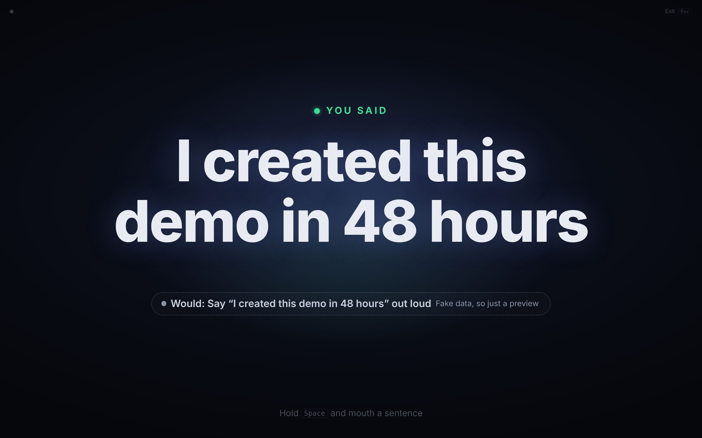

# Make it yours

Change who gets your texts, what music plays and what the Mac says. Film it with the demo screen. Or fork it and
change the sentences.

**Contents:** [Your text contact](#your-text-contact) ·
[Your focus music](#your-focus-music) ·
[What each sentence does](#what-each-sentence-does) ·
[The settings file](#the-settings-file) ·
[The demo screen](#the-demo-screen) ·
[Change the sentences](#change-the-sentences-fork) ·
[Host your own dashboard](#host-your-own-dashboard-fork)

## Your text contact

"Text mom I'm on my way", "Call me back later" and "I need help right now" send iMessages. They go to the contact you
set, and only to that contact. There is no default: with no contact set, these sentences send nothing.

- **Mac app:** click **Text contact…** in the **Settings** box. Type the number, click **Next**, check it, click
  **Yes, save**. The window then shows it as **Texts go to: +61 •••• ••12**. Step by step:
  [Setup, step 8](setup.md#8-set-your-contact-and-music).
- **From source:** `mac/set-contact.sh` does the same from Terminal. It prints only the last 2 digits.

Rules:

- A mobile number **with + and the country code** (for example +61 4xx xxx xxx). Numbers without the country code,
  email addresses and names are refused.
- Both ways set the **same contact for all three** texting sentences. You can give each one its own contact in the
  [settings file](#the-settings-file).
- Messages on your Mac must be signed in to iMessage.
- **Start with your own number**, so your first tests text you.

## Your focus music

"Play my focus music" uses Apple Music by default.

- **Mac app:** click **Focus music…** in the **Settings** box. The window then shows **Plays: ...**.
- **From source:** `mac/set-music.sh "<what>"`.

What you can give it:

| You give | It plays |
|---|---|
| A playlist name, like `Focus` | That playlist from your Music library. If there is no playlist by that name, the link below |
| An Apple Music link (`https://music.apple.com/...` or `music://...`) | That playlist (needs an Apple Music subscription) |
| A Spotify link (`spotify:playlist:...` or an `open.spotify.com` link) | That playlist in Spotify (Spotify must be installed and logged in) |
| Nothing | Apple Music's public "Pure Focus" playlist |

With Apple Music, if nothing plays after a few seconds (for example, no subscription), it shuffles your Music library
instead.

## What each sentence does

| Sentence | Default action | You can change |
|---|---|---|
| Text mom I'm on my way | iMessage "On my way!" to your contact | The contact, the message |
| Turn the volume up | Volume up 15% (max 100%), and unmute | The step, 1 to 50 |
| Call me back later | iMessage "Can't talk now, call me back later" to your contact | The contact, the message |
| I created this demo in 48 hours | The Mac says "I created this demo in 48 hours" out loud. The dashboard throws confetti | What it says |
| I need help right now | Alarm sound, red notice above every window, Dock icon bounces, iMessage "I need help right now" to your contact. The dashboard shows a full screen red alert. It never calls emergency services | The contact, the message |
| What's on my calendar today? | Reads today's events and speaks one sentence about them (Apple's on device model on macOS 26 with Apple Intelligence on, otherwise a plain list) | Nothing yet |
| Play my focus music | See [Your focus music](#your-focus-music) | The playlist, Apple Music or Spotify |
| Mouth closed (say nothing) | Nothing | |

Speech plays through the Mac's sound output, so through your AirPods when they are connected.

## The settings file

Everything above lives in one file on your Mac: `~/.silentspeech/actions.json`. The buttons and scripts write it for
you. You can also edit it by hand in any text editor. The app reads it again before every action, so there is no need
to restart.

```json
{
  "text_mom":    { "kind": "imessage", "to": "+61XXXXXXXXX", "text": "On my way!" },
  "call_back":   { "kind": "imessage", "to": "+61XXXXXXXXX", "text": "Can't talk now, call me back later" },
  "help":        { "kind": "imessage", "to": "+61XXXXXXXXX", "text": "I need help right now" },
  "volume_up":   { "kind": "volume", "step": 15 },
  "focus_music": { "kind": "applemusic", "playlist": "Focus" },
  "demo_48h":    { "kind": "say", "text": "I made this over a weekend" },
  "calendar":    { "kind": "calendar" }
}
```

(`+61XXXXXXXXX` stands for your number.) Each entry needs its `kind`:

| kind | Used by | Fields |
|---|---|---|
| `imessage` | `text_mom`, `call_back`, `help` | `to`: + and country code. `text`: the message (up to 300 characters) |
| `volume` | `volume_up` | `step`: percent, 1 to 50 |
| `applemusic` | `focus_music` | `playlist`: a library playlist name. `url`: an Apple Music link |
| `spotify` | `focus_music` | `uri`: a Spotify playlist, album or track (`spotify:...` or an `open.spotify.com` link) |
| `say` | `demo_48h` | `text`: what the Mac says out loud (up to 300 characters) |
| `calendar` | `calendar` | none |

**The "say" line:** change `demo_48h`'s `text` to make the Mac say anything you like when you mouth "I created this
demo in 48 hours". You still mouth the same sentence; only what the Mac says changes.

Good to know:

- Each sentence can only use its own kind (for example, only the three texting sentences can ever send a text).
- An entry with a mistake is skipped, and that sentence uses its default. A file that is not valid JSON is ignored
  as a whole. The app's log says which.
- The app's log shows contacts only as their last 2 digits (like `••42`). The file itself is only readable by your user.
  Never commit it or paste it anywhere.

## The demo screen

For filming. On the Recognize screen, click **Demo screen**. The page goes full screen and shows only the sentence,
big. Press <kbd>Esc</kbd> (or **Exit** in the corner) to leave.



What is different on the demo screen:

- **Texts are never sent from it.** Not "Text mom", not "Call me back later", not "I need help". When a text would
  have gone out, the screen shows a text bubble instead, with **Demo: not sent** under it, for 5 seconds. Any action
  that is not on the harmless list is held back the same way.
- **"I need help right now"**: when a real help text would have gone out (live, Armed, paired, your own model, every
  check passes), the red alert says **Demo: no text sent** and the browser plays about one second of alarm beeps.
  If the guess is sure enough but another check fails (for example, the app is not Armed), the red alert shows the
  usual **Would: …** line and makes no sound.
- **Harmless actions still run** on the Mac when every check passes: volume, focus music, calendar, the demo line.
- **Every sentence it shows is spoken out loud** by the browser, "Probably" ones too, so the video has sound. The one
  exception is the demo line when the Mac is already saying it.
- A small dot in the top left corner turns green when the page is live and the Mac app is Armed.

Outside the demo screen, the Recognize screen has a **Say it out loud** switch that speaks sentences it is sure about.

## Change the sentences (fork)

The 7 sentences are fixed in this repo. Changing them means forking the project, hosting your own dashboard and
building your own Mac app. Here is honestly what that takes.

**Reword a sentence** (same action, different words):

1. Edit `sentence` in [`shared/classes.json`](../shared/classes.json). Keep the `id`: everything else is keyed on it.
2. Update the words the dashboard uses to describe the action, in `web/src/panels/result/text.ts` (and the demo
   screen's text bubbles in `web/src/panels/result/demo-screen.ts`).
3. **Record that sentence again**, and delete your old takes of it (they are of the old words). The model only knows
   motion, so old takes would teach it the wrong thing.

**Add a sentence or a new action:**

1. Add `{ "id", "sentence", "action" }` to [`shared/classes.json`](../shared/classes.json).
2. In the Mac app, [`mac/SilentSpeechBridge/ActionRunner.swift`](../mac/SilentSpeechBridge/ActionRunner.swift):
   add the action to `actionKeys` (the list the app offers) and to `allowedKinds` (which kinds it may use: an existing
   one like `say` or `volume`, or a new `ActionKind` you write). If it messages a person, also add it to
   `textingActions` and to `sensitiveActions` in [`Protocol.swift`](../mac/SilentSpeechBridge/Protocol.swift)
   (30 second cooldown). Rebuild the app.
3. In the dashboard, [`web/src/panels/result/rule.ts`](../web/src/panels/result/rule.ts): a new action is **strict
   by default** (it needs 70% and the model's accept, like texts). Only add it to `LOOSE_ACTIONS` if it can never
   reach another person. Add it to `MESSAGING_ACTIONS` if it messages someone. Describe it in `text.ts`.
4. **Record every sentence again**, the new one included, at least 5 times each. Your model only runs actions when
   every sentence in `classes.json` has 5 takes. Spiro's public model and the replay only know the original 8 and
   will not recognize the new one.
5. Run the tests (see [CONTRIBUTING.md](../CONTRIBUTING.md)). Some tests know the original sentences.

**Remove a sentence:** remove it from `classes.json`. Removing it from the Mac app too is tidier, but not needed: the
dashboard never asks for an action that has no sentence.

The contract between the Mac app and the dashboard is written down in [docs/dev/PROTOCOL.md](dev/PROTOCOL.md).

## Host your own dashboard (fork)

The Mac app only talks to web pages from addresses it knows. Built in: `https://spiro-12.github.io` and the local
development addresses (`allowedOrigins` in
[`mac/SilentSpeechBridge/Protocol.swift`](../mac/SilentSpeechBridge/Protocol.swift)). A page from any other address is
refused before it can even connect, and the app's log says `Blocked a website: ...`.

**1. Host it.**

1. Fork the repo. On GitHub: Settings > Pages > Source: **GitHub Actions**. The
   [Pages workflow](../.github/workflows/pages.yml) builds and deploys on every push to `main`.
2. If your fork is not called `silent-speech`, change `base` in [`vite.config.ts`](../vite.config.ts) to
   `/<your-repo>/`, and the `/silent-speech/` check at the end of the Pages workflow.
3. Search the repo for `spiro-12` and `Spiro-12` to update the links the page shows.

**2. Let the Mac app talk to it.** No rebuild needed: create `~/.silentspeech/config.json` on your Mac with your
site's origin:

```json
{ "allowedOrigins": ["https://yourname.github.io"] }
```

- An origin is only the scheme and host (and port, if any), with no path and no `/` at the end. Exactly what the
  browser sends.
- `https` only, except `http://localhost` and `http://127.0.0.1`.
- The app reads this file when it starts, so quit it (Cmd+Q) and open it again. Its log then says
  `config.json: also allowing the dashboard at https://yourname.github.io`, or says why it skipped an entry.

**3. Open it paired.** The app's **Open dashboard** button still opens Spiro's dashboard. Until you change that, open
yours by hand with the pairing code from `~/.silentspeech/token`:

```bash
open -a "Google Chrome" "https://yourname.github.io/silent-speech/?mode=live#pair=$(cat ~/.silentspeech/token)"
```

(The shell fills in the code; nothing is printed. Do not paste the code anywhere.) To make the button open your page
instead, change `dashboardBase` in [`mac/SilentSpeechBridge/Pairing.swift`](../mac/SilentSpeechBridge/Pairing.swift)
and rebuild the app ([Setup, option B](setup.md#option-b-build-it-from-source)). You can also add your origin to
`allowedOrigins` in `Protocol.swift` there, instead of using `config.json`.

An origin covers every page on that site (every repo you host on `yourname.github.io`), which is why actions also need
the pairing code. See [Safety and privacy](safety-privacy.md#only-your-dashboard-can-ask).

**For local development** you do not need any of this: `npm run dev` serves the dashboard at
`http://localhost:5173/silent-speech/`, which the app already allows. See [CONTRIBUTING.md](../CONTRIBUTING.md).
