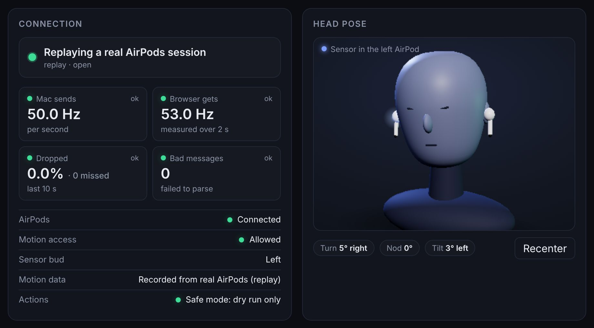
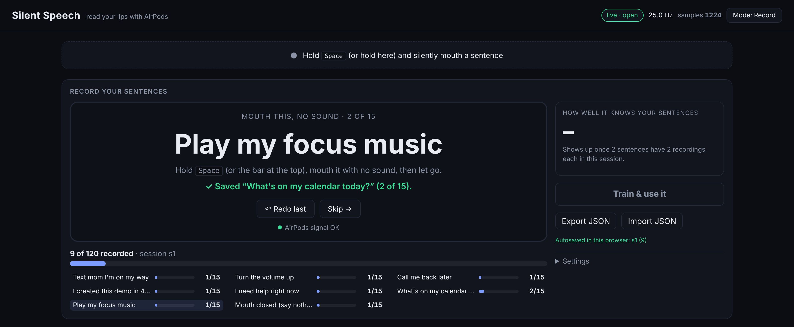
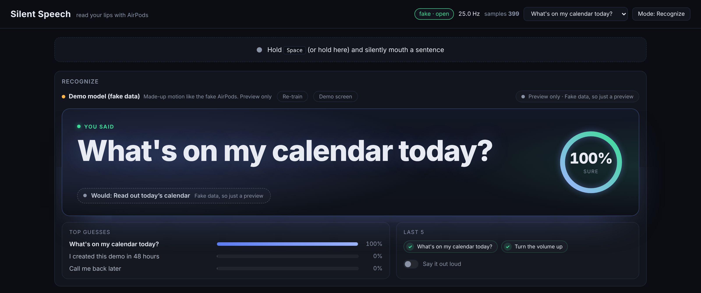

# Setup

This guide takes you from nothing to "I mouthed a sentence and my Mac did it". It takes about 20 minutes, most of it
recording. Every popup you will see is listed, with what to click.

**Contents:** [What you need](#what-you-need) ·
[1. Get the Mac app](#1-get-the-mac-app) ·
[2. Open it the first time](#2-open-it-the-first-time) ·
[3. Put in your AirPods](#3-put-in-your-airpods) ·
[4. Open the dashboard](#4-open-the-dashboard) ·
[5. Check the status](#5-check-the-status) ·
[6. Record your sentences](#6-record-your-sentences) ·
[7. Recognize](#7-recognize) ·
[8. Set your contact and music](#8-set-your-contact-and-music) ·
[9. Turn on Armed](#9-turn-on-armed) ·
[Every time after](#every-time-after) ·
[Remove everything](#remove-everything)

## What you need

| | |
|---|---|
| **Mac** | macOS 14 (Sonoma) or newer. Apple's AirPods motion API needs it. |
| **AirPods** | AirPods with head tracking. **Tested: AirPods Pro 3.** Apple's head tracking also covers AirPods Pro, AirPods Pro 2, AirPods Max and AirPods (3rd generation) or newer, so those should work, but nobody has tested them with this yet. |
| **Browser** | **Google Chrome** is recommended. The dashboard is a secure (https) page that talks to the Mac app at a local address (`ws://127.0.0.1:8765`). Chrome allows that after one click; other browsers may block it. |
| **Messages** | Only for the texting sentences: Messages on the Mac, signed in to iMessage. |

Two words used below:

- **Mac app**: SilentSpeechBridge, a small app that reads the AirPods motion sensor and does the actions.
- **Dashboard**: the web page at https://spiro-12.github.io/silent-speech/ where you record and recognize. It runs in
  your browser, on your Mac.

## 1. Get the Mac app

Pick one.

### Option A: download it (easiest)

1. Download **[SilentSpeechBridge-macOS.zip](https://github.com/Spiro-12/silent-speech/releases/latest/download/SilentSpeechBridge-macOS.zip)**
   (always the newest release).
2. Double click the zip to unzip it. You get **SilentSpeechBridge.app**. It runs on Apple silicon and Intel Macs.
3. Drag it into your **Applications** folder.

Optional check: each release page also lists the zip's SHA-256 fingerprint (and has a `.sha256` file). In Terminal,
`shasum -a 256 ~/Downloads/SilentSpeechBridge-macOS.zip` must print the same.

### Option B: build it from source

You need Apple's Command Line Tools (free, about 1 GB). You do **not** need Xcode.

```bash
xcode-select --install          # once; a popup asks to install the tools, click Install
git clone https://github.com/Spiro-12/silent-speech.git
cd silent-speech/mac
./make-cert.sh                  # optional, once: see below
./build.sh                      # makes build/Debug/SilentSpeechBridge.app
open build/Debug/SilentSpeechBridge.app
```

`./build.sh --release` makes the same optimized, universal (Apple silicon + Intel) app as the download, in
`build/Release/`.

`make-cert.sh` makes a signing identity called "SilentSpeech Local" in your login keychain. With it, macOS remembers
the app's permissions (motion, Messages, calendar) when you build it again. It asks for your Mac password to trust the
certificate, then shows a popup "codesign wants to sign using key": type your password and click **Always Allow**.
It should end with `OK: signing works.`

Without it, `build.sh` still works: it signs the app "ad hoc" (a throwaway signature) and prints a one line note.
The only downside is that macOS may ask for the permissions again after each rebuild.

## 2. Open it the first time

Skip this if you built it yourself.

The downloaded app is not signed by Apple (that costs a paid developer account), so macOS blocks it the first time:

1. Double click **SilentSpeechBridge** in Applications. macOS says it cannot be opened or that Apple could not check
   it. Click **Done** (or **OK**).
2. Open **System Settings > Privacy & Security**. Scroll down to the **Security** section. Next to the message about
   SilentSpeechBridge, click **Open Anyway**, then type your Mac password.
3. Click **Open** (or **Open Anyway**) in the last popup. From now on it opens normally.

If you are comfortable with Terminal, this does the same in one line:

```bash
xattr -dr com.apple.quarantine /Applications/SilentSpeechBridge.app
```

You can read every line of the app's code in [`mac/SilentSpeechBridge/`](../mac/SilentSpeechBridge), and build it
yourself (option B) if you would rather not trust a download.

The app opens a window called **Silent Speech Bridge**. At the top, a **Get started** box lists the next three steps,
each with a dot that turns green when it is done:

1. Put in your AirPods.
2. Allow Motion access when macOS asks.
3. Click Open dashboard below. It opens in your browser, paired with this app.

Below it are the **AirPods**, **Dashboard**, **Settings** and **Log** boxes. No AirPods yet? Turn on
**Simulate motion** in Settings to see fake motion flow to the dashboard. Nothing real can happen while Armed is off.

> The app keeps your Mac awake while it runs (so the motion keeps flowing). Closing the window does **not** quit it.
> Quit with **Cmd+Q** when you are done. Clicking its Dock icon brings the window back.

## 3. Put in your AirPods

1. Put your AirPods in and make sure they are connected to **this Mac** and are its **sound output**
   (Control Center > Sound, pick your AirPods).
2. macOS asks whether Silent Speech Bridge may use your motion data. Click **Allow** (or **OK**). If you clicked
   no by mistake, step 2 in Get started turns orange: turn it on in System Settings > Privacy & Security (see
   [Troubleshooting](troubleshooting.md#i-missed-a-permission-popup-or-clicked-dont-allow)).
3. In the app window, the **AirPods** box should show:
   - Headphones: **Connected**
   - Motion permission: **Allowed**
   - Sensor bud: **left** or **right** (only one AirPod sends motion at a time, and macOS picks which)
   - Live rate: about **50 Hz** (50 readings a second) on AirPods Pro 3; older AirPods may give about 25 Hz
   - Gaps: under 5%

**Tip: wear one AirPod**, or at least notice which one is the sensor. The model learns the motion of one ear, and it
does much worse on the other one. More on this in [Train it on your mouth](calibration.md#1-pick-your-ear).

## 4. Open the dashboard

1. Make **Chrome your default browser** (System Settings > Desktop & Dock > Default web browser), or the next step
   opens a different browser.
2. In the app window, in the **Dashboard** box, click **Open dashboard**.
3. The dashboard opens. If Chrome asks to let the page **access other apps and services on this device**, click
   **Allow**. (That is how the page reaches the Mac app.)

The **Open dashboard** link carries a secret pairing code. The dashboard keeps it only in that tab's memory (never
saved anywhere), and the Mac app only runs actions for a page that has it.

> **Always open the dashboard from the Mac app's button.** If you reload the page, close the tab, or type the address
> yourself, the motion still shows, but the page is no longer paired and cannot run actions. Click
> **Open dashboard** again.

## 5. Check the status

Scroll down to the **Connection** and **Head pose** cards.



<sub>Shown here on the replay of Spiro's session. With your own AirPods the "Motion data" row says "Real AirPods".</sub>

Good looks like this:

- The top line says **Streaming from AirPods**.
- **Mac sends** and **Browser gets** are about **50 Hz** (or about 25 Hz on older AirPods), marked "ok".
- **Dropped** is under 5%.
- **Sensor bud** says Left or Right, and the head picture says **Sensor in the left AirPod** (or right).
  Remember which one.
- **Actions** says **Safe mode: dry run only**. That is right for now.

Nod your head: the 3D head should nod with you. If something looks wrong, see
[Troubleshooting](troubleshooting.md#the-page-cant-reach-the-mac-app-or-the-rate-is-0).

## 6. Record your sentences

The page starts in **Record** mode (the button at the top right says **Mode: Record**).



1. Read the sentence on screen. Wait until it turns solid white.
2. **Hold <kbd>Space</kbd>** (or hold the bar at the top of the page), wait a moment, **mouth the sentence with no
   sound**, wait a moment, then **let go**.
3. The page saves the take and shows the next sentence. Made a mistake? Press **Redo last**.
4. For **Mouth closed (say nothing)**, keep your mouth closed and still while you hold Space. Do not nod or swallow.

The sentences come in a shuffled order. By default you record each one **15 times** (Settings > Recordings per
sentence). Your model needs **at least 5 takes of every sentence**, "Mouth closed" included, before it may run actions.

Your takes are saved in this browser as you go. **Export JSON** saves a backup file, and **Import JSON** loads one.

How you record makes a big difference. Read **[Train it on your mouth](calibration.md)** before your first session.
It is short.

## 7. Recognize

1. Click **Mode: Record** at the top right to switch to **Mode: Recognize** (or press **Train & use it**).
2. The Recognize card trains a model on your takes. Its top line should say **Your model: N recordings** and
   **Can run actions on your Mac**.
3. Hold <kbd>Space</kbd>, mouth any of the sentences, let go.



<sub>Shown with fake data. With your AirPods and your model, the model line says "Your model".</sub>

You see the sentence in big letters with a ring that shows how sure it is:

- **You said**: sure enough for any action (70% or more, and the model accepts it).
- **Probably**: 50% to 70%. Only harmless actions (volume, music, calendar, the demo line) may run.
- **Not sure, try again**: under 50%. Nothing runs.

Under the sentence, a chip says what happened. While the Mac app is not Armed it says **Would: ...** and why it did
not run, for example "Safe mode: turn on Armed in the Mac app". Recorded more takes? Press **Re-train**.

## 8. Set your contact and music

Three sentences send a text: "Text mom I'm on my way", "Call me back later" and "I need help right now". They all go
to **one contact**, which you set on the Mac. There is no default contact, so until you set one these sentences send
nothing.

Both settings are buttons in the Mac app window, in the **Settings** box.

**Text contact…**

1. Click **Text contact…**. Type a mobile number **with + and the country code** (for example +61 4xx xxx xxx).
   Email addresses and numbers without the country code are not accepted. Click **Next**.
2. A second box shows the number back. Click **Yes, save** only if it is right. (**No** is the default, so pressing
   Return saves nothing.)
3. The window now says **Texts go to: +61 •••• ••12** (the country code and the last 2 digits of your number).

**Tip: use your own number first**, so your first test texts go to you.

**Focus music…**

Click **Focus music…** and type one of these, then confirm with **Yes, save**. The window then says **Plays: ...**.

- a playlist name from your Music library, like `Focus`
- an Apple Music link (`https://music.apple.com/...`)
- a Spotify link (`https://open.spotify.com/playlist/...` or `spotify:playlist:...`), if Spotify is installed

Both buttons write `~/.silentspeech/actions.json` on your Mac, keep everything else in it, and make it readable only by
your Mac user. It never leaves your Mac. If you work from the source code, `mac/set-contact.sh` and
`mac/set-music.sh "<what>"` do the same from Terminal (they need [Node.js](https://nodejs.org)).

Without any music setting, "Play my focus music" opens Apple Music's public "Pure Focus" playlist; if that does not
play (no Apple Music subscription), it shuffles your Music library.

More options (the message text, the spoken line, the volume step): [Make it yours](make-it-yours.md).

## 9. Turn on Armed

When the dashboard gets your sentences right:

1. In the Mac app window, under **Settings**, turn on **Armed (let actions really run)**.
2. The dashboard's pill changes to **Live: sentences run on your Mac**.
3. Mouth a sentence. The Mac does it.

Armed is **off every time the app starts**, and it can only be switched on in the app window, by you. Turn it off any
time: anything not started yet is cancelled.

The first time each kind of action runs, macOS asks once:

| Action | Popup | Click |
|---|---|---|
| A text | "Silent Speech Bridge wants access to control Messages" | **OK** (or **Allow**) |
| Focus music | "... wants access to control Music" (or Spotify) | **OK** (or **Allow**) |
| Calendar | "... would like full access to your calendar" | **Allow Full Access** |
| Volume, the demo line | none | |

The popup can take a few seconds to appear. If you clicked **Don't Allow** by mistake, see
[Troubleshooting](troubleshooting.md#i-missed-a-permission-popup-or-clicked-dont-allow).

What each action does, exactly:

- **Texts** go through Messages to your contact. "Help" also plays an alarm, shows a red notice above every window, and
  bounces the Dock icon. It never calls emergency services.
- **Volume** goes up 15% (up to 100%) and unmutes.
- **Calendar** reads today's events and speaks one sentence about them. On macOS 26 with Apple Intelligence on, Apple's
  on device model writes the sentence; otherwise it reads a plain list. Event titles never leave your Mac.
- **The demo line** is spoken by the Mac's voice.
- Speech plays through the Mac's sound output, so through your AirPods.

## Every time after

1. Open **SilentSpeechBridge** and put in your AirPods (same ear as when you recorded).
2. Click **Open dashboard**.
3. Switch to **Recognize**. Your takes are still there; the model trains again in a second.
4. Turn on **Armed** if you want actions to run.
5. Quit the app with **Cmd+Q** when you are done.

## Remove everything

1. Quit the app (Cmd+Q) and move it to the Trash.
2. Delete its settings folder and log (Finder > Go > Go to Folder):
   - `~/.silentspeech` (the pairing code and your contact and music settings)
   - `~/Library/Logs/SilentSpeechBridge.log`
3. Forget its permissions: in Terminal, `tccutil reset All com.spiro.SilentSpeechBridge`.
4. Your recordings live in Chrome's storage for spiro-12.github.io. To delete them: in the dashboard, Record mode,
   Settings > **Clear this session…** for each session, or remove the site's data in Chrome's settings.
5. If you ran `make-cert.sh`: open Keychain Access and delete "SilentSpeech Local" from the login keychain.
