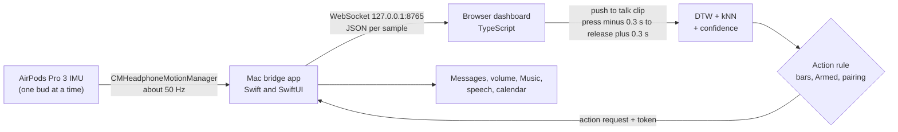

# Technical report

Recognizing silently mouthed sentences from the head tracking motion sensor in stock AirPods: what we built, how it
works, what the numbers say, and where it is weak. Written for ML and sensing readers. For a plain introduction, see
[How it works](how-it-works.md) and [Results](results.md).

*Status: Nov 11, 2026. One subject. Numbers will change as more people record.*

## Contents

- [Summary](#summary)
- [1. Problem and framing](#1-problem-and-framing)
- [2. System](#2-system)
- [3. Data](#3-data)
- [4. Method](#4-method)
- [5. Results](#5-results)
- [6. Threats to validity](#6-threats-to-validity)
- [7. Open questions](#7-open-questions)
- [8. Reproduce it](#8-reproduce-it)

## Summary

- **Task.** Closed vocabulary, user dependent, push to talk classification of **7 mouthed sentences plus "nothing"**
  (8 classes, chance 12.5%) from the AirPods IMU, read through Apple's public `CMHeadphoneMotionManager` at about
  50 Hz. No audio, no camera.
- **Model.** Multivariate DTW (Sakoe-Chiba band) with distance weighted kNN (k = 3) on 6 high passed channels, plus a
  confidence score built to reject unknown or still inputs. It runs in the browser at about 13 ms per clip.
- **Accuracy (one subject).** Leave one session out over 5 sessions on the same ear: **98.1%** (468/477, 95% CI 96.5
  to 99.0). On the 3 published sessions with hyperparameters chosen inside the cross validation: **88.2%**. A label
  shuffle test gives p = 0.002.
- **Safe actions.** At the confidence bar used for texts (0.70), 81% of sentences act on the first try with **0 wrong
  actions out of 339 fired**, and 0 of 57 "nothing" takes fire.
- **Not just length.** Clip duration alone gets 27.5%. Duration plus per channel movement strength gets 54.5%. DTW gets
  98.1%, so the information is in the temporal shape.
- **Biggest weaknesses.** One subject, 2 days, one chair. The sensing ear matters a lot (about 57 to 69% across
  ears). Fixed vocabulary with explicit segmentation.

## 1. Problem and framing

Voice interfaces assume you can and want to speak out loud. Silent speech interfaces recognize articulation without
sound, usually with EMG, cameras, radar or sonar on extra hardware. AirPods already contain an IMU for spatial audio
head tracking, and macOS 14+ exposes it to native apps. Mouthing moves the jaw, and the jaw moves the skull and ear
canal a little. The question was whether that is enough signal to tell a small set of everyday sentences apart, with
no new hardware.

We framed it as **whole sentence classification**: each sentence is one token. Sentences differ in length, syllable
rhythm and how much the mouth opens, which is what a 50 Hz head IMU can plausibly see. Lip and tongue detail is mostly
invisible to it.

### Closest prior work

| System | Sensor | Reported result |
|---|---|---|
| SwanTrumpet (IMWUT 2025) | Built in IMU of 2 commercial earbuds, about 25 Hz | About 91% word accuracy, user independent; code and data on Zenodo |
| MuteIt (UbiComp 2022) | IMU on the jaw joint plus a reference IMU | About 95% on 100 commands |
| Unvoiced (SenSys 2024) | Jaw IMU to spectrogram to a speech model and an LLM | Under 9% WER on open phrases |
| EchoSpeech (CHI 2023) | Sonar on glasses | About 95% on 31 commands |
| LipLearner (CHI 2023) | Phone camera | F1 0.89 from 1 example per command |

These figures come from our [research notes](dev/RESEARCH.md), partly built from search summaries. Check each against
the paper before citing it.

What this project adds: silent sentence recognition on **stock AirPods through the public Apple API**, as an **open
source, end to end system that runs real actions**. SwanTrumpet is the closest scientific prior and is stronger on
user independence.

## 2. System



- **Sensor stream.** `CMDeviceMotion` gives attitude (quaternion), `rotationRate`, `userAcceleration`, gravity and
  `sensorLocation` (left or right bud). On AirPods Pro 3 we measured 49 to 50.5 Hz with 0.2 to 0.4% gaps. macOS
  chooses which bud streams.
- **Bridge.** A small macOS app (Network.framework WebSocket on loopback only) streams samples, enforces an origin
  allowlist and a pairing token stored on the Mac (passed to the page in the link the app opens), and runs actions only
  when the user has switched on "Armed". Actions: iMessage through AppleScript, system volume, Apple Music or Spotify,
  speech (AVSpeechSynthesizer), and a calendar readout (EventKit, summarized on device with Apple's FoundationModels on
  macOS 26).
- **Dashboard.** Vite and plain TypeScript, a static site on GitHub Pages. Spacebar push to talk cuts a clip from a
  ring buffer with 0.3 s of padding on each side. Recording, training and inference all happen in the browser, and
  recordings stay in IndexedDB. A Python benchmark ([`ml/`](../ml/)) implements the same pipeline and agrees with the JS
  version clip for clip.
- **Action gating.** Harmless actions fire from confidence 0.5 and up. Texts need the model's own accept at 0.70 or
  more. Only a "full own model" may act: every class, including "nothing", with at least 5 takes recorded in this
  browser. Cooldowns are 3 s, and 30 s for texts. Requests older than 60 s are dropped. Details:
  [Safety and privacy](safety-privacy.md).

## 3. Data

One subject (Spiro), AirPods Pro 3, seated with his head resting against a chair, prompted sentences in shuffled
order, 15 takes per class per session, silent mouthing. "Nothing" means mouth closed and still. The median clip
length (press to release) is 3.7 s (s5: 3.1 s).

| Session | When | Sensing ear | Clips used | Excluded | Public |
|---|---|---|---:|---:|---|
| s1 | Oct 31, 16:21 | right | 105 | 15 | yes |
| s2 | Oct 31, 16:37 | left | 117 | 3 | yes |
| s3 | Oct 31, 16:54 | left | 120 | 0 | yes |
| s4 | Nov 1, morning | left | 120 | 0 | not yet |
| s5 | Nov 1, 09:17 | left | 120 | 0 | not yet |
| **Total** | 2 days | 4 left, 1 right | **582** | 18 | |

- **Exclusions.** In s1 and s2, some "nothing" takes were the words "stay still" mouthed by mistake (the old prompt).
  18 clips are excluded by id in [`data/raw/exclude.json`](../data/raw/exclude.json). The raw files are never edited.
- **Label drift in "nothing".** In s1 to s3 the remaining "nothing" takes include nods and swallows. From s4 on, the
  prompt said "mouth closed and still", so "nothing" became nearly motionless. That is a known shift.
- **Format.** One JSON per session: for each clip its id, label, session, press and release times, padding, ear and
  raw samples (t, q, rr, ua, g). The schema is in [PROTOCOL.md](dev/PROTOCOL.md) §3. The published sessions are in
  [`data/raw/`](../data/raw/README.md).

## 4. Method

### Preprocessing (identical in JS and Python)

0. **Ear normalization.** If the clip came from the right bud, mirror it into the left frame: `rr → (x, −y, −z)`,
   `ua → (−x, y, z)`. This is a sagittal reflection: `ua` is a vector and `rr` a pseudovector.
1. **Uniform grid.** Sort and deduplicate timestamps, then linearly interpolate onto a 50 Hz grid.
2. **Channels.** `rr.x rr.y rr.z ua.x ua.y ua.z` (6).
3. **High pass.** 2nd order Butterworth at 1 Hz, zero phase (`filtfilt`, odd padding, `padlen = min(9, n − 1)`), to
   remove posture drift.
4. **Resample** to L = 96 points.
5. **Normalize per clip.** z-score each channel by its own mean and std, with a std floor of 0.5 × the training median
   of that channel's per clip std. This cancels loudness differences between sessions and was worth about 10 points
   of LOSO accuracy over global normalization.

### Classifier

Dependent multivariate DTW (one warping path for all channels), squared Euclidean local cost, Sakoe-Chiba band r = 5
(5% of L). The label is a k = 3 nearest neighbour vote, weighted by 1/d.

### Confidence

```text
dRef        = median over templates of the DTW distance to the nearest other template of the same class
d_c         = distance from the clip to the nearest template of class c
competitors = { d_c for every class } ∪ { unknown: 1.7·dRef } ∪ { stillness: 1.25·Σq² }
separation  = softmax(−d / T) at the predicted label,   T = 0.1·dRef
vote        = the label's share of the k neighbour weights
confidence  = vote × separation
accepted    = label ≠ none and confidence ≥ threshold
```

The two virtual competitors make confidence fall when a clip is far from every template, not only when two classes
are close. That stops small or partial models from accepting random motion. With per clip normalization, Σq² is about
channels × L = 576, so "stillness" sits near 720. On the public model dRef is 421, so "unknown" sits near 716. Models
with fewer than 2 classes or an undefined dRef fall back to a scale free softmax capped at threshold / 2, so they can
never accept. Full specification: [PROTOCOL.md](dev/PROTOCOL.md) §6 and the header of
[`web/src/ml/knn.ts`](../web/src/ml/knn.ts).

### Hyperparameters

L 96, band 0.05, k 3, per clip normalization and the 0.85 model threshold were picked by a 768 configuration LOSO
sweep on s1 to s3. For an honest number, a nested version picks the configuration without the test session
(section 5.1). s4 and s5 were recorded after tuning, so they are clean test sessions for the defaults. The 0.70 bar
for texts was picked later, after seeing all 5 sessions.

## 5. Results

All results are from one subject. The 95% Wilson intervals treat clips as independent, which overstates certainty:
takes within a session are correlated, and there are only 5 sessions.

### 5.1 Published benchmark (s1 to s3, 342 clips, leave one session out)

| Model | LOSO | Test s1 (right) | s2 | s3 | Settings |
|---|---:|---:|---:|---:|---|
| DTW + kNN, tuned | 94.2% | 83.8% | 97.4% | 100% | picked on these folds |
| **DTW + kNN, nested** | **88.2%** | 67.1% | 96.6% | 98.3% | chosen without the test session |
| DTW, Phase 1 settings (L 64, k 1, global norm) | 81.9% | 64.8% | 94.0% | 85.0% | fixed before the data |
| MiniRocket (10k kernels) + ridge | 76.3% | 49.5% | 92.3% | 84.2% | fixed before the data |
| MiniRocket, L96 + per clip norm | 84.8% | 64.8% | 95.7% | 91.7% | borrows the DTW sweep's preprocessing |
| 1D CNN | 76.6% | 51.4% | 91.5% | 84.2% | fixed before the data |
| 1D CNN, L96 + per clip norm | 79.2% | 54.3% | 92.3% | 88.3% | borrows the DTW sweep's preprocessing |

MiniRocket and the CNN vary by a few points across seeds (MiniRocket L96: 83.9 to 88.3% over seeds 0 to 4), so DTW's
lead over MiniRocket is within that noise. In the label shuffle test (500 shuffles inside each LOSO fold), shuffled
models score 12.5% ± 2.9 against a real 94.2%, so p = 0.002. Untuned DTW and MiniRocket also get p = 0.002. Full
tables: [`ml/RESULTS.md`](../ml/RESULTS.md).

### 5.2 All 5 sessions, DTW defaults, leave one session out

| Held out | Ear | Correct | Accuracy |
|---|---|---:|---:|
| s1 | right (mirrored) | 60 / 105 | 57.1% |
| s2 | left | 113 / 117 | 96.6% |
| s3 | left | 120 / 120 | 100% |
| s4 (after tuning) | left | 117 / 120 | 97.5% |
| s5 (after tuning) | left | 118 / 120 | 98.3% |
| **Left ear pooled** | | **468 / 477** | **98.1%** [96.5, 99.0] |
| All 5 pooled | | 528 / 582 | 90.7% [88.1, 92.8] |

Confusion over the 4 left ear folds (rows true, columns predicted). Most of the few errors fall into "nothing", which
is the safe direction.

| true \ pred | calendar | call_back | demo_48h | focus_music | help | none | text_mom | volume_up |
|---|---:|---:|---:|---:|---:|---:|---:|---:|
| **calendar** | **59** | . | . | 1 | . | . | . | . |
| **call_back** | . | **60** | . | . | . | . | . | . |
| **demo_48h** | . | . | **58** | . | . | 2 | . | . |
| **focus_music** | . | 1 | . | **58** | . | 1 | . | . |
| **help** | . | . | . | . | **57** | 2 | . | 1 |
| **none** | . | . | 1 | . | . | **56** | . | . |
| **text_mom** | . | . | . | . | . | . | **60** | . |
| **volume_up** | . | . | . | . | . | . | . | **60** |

### 5.3 Is it just length or loudness?

| Features (same kNN, same LOSO, 4 left ear folds) | Accuracy |
|---|---:|
| Clip duration only | 27.5% |
| Duration + per channel movement std (7 features) | 54.5% |
| **DTW on the full 6 channel time series** | **98.1%** |

Sentence length and overall movement carry some signal, as expected, but the temporal shape does most of the work.

### 5.4 More sessions beat more takes

| Training sessions, test s5 | Accuracy | Training sessions, test s4 | Accuracy |
|---|---:|---|---:|
| s4 | 91.7% | s5 | 86.7% |
| s3 + s4 | 97.5% | s3 + s5 | 96.7% |
| s2 + s3 + s4 | 98.3% | s2 + s3 + s5 | 96.7% |
| s1 + s2 + s3 + s4 | 98.3% | s1 + s2 + s3 + s5 | 97.5% |

Enrollment curve with a single training session (k takes per class from s4, tested on s5, and the reverse; mean of 5
random draws):

| Takes per class | 1 | 2 | 3 | 5 | 8 | 10 | 15 |
|---|---:|---:|---:|---:|---:|---:|---:|
| Accuracy on the other session | 61% | 52% | 64% | 73% | 81% | 84% | 89% |

The dip at 2 takes is a k = 3 artifact: with only 2 templates per class, the third vote always comes from another
class. The takeaway is that session variety (re-seating the AirPods, a different day) matters more than more takes in
one sitting. Within session leave one clip out ranges from 85.0% (s4) to 100% (s3).

### 5.5 Selective classification: how often it acts, and how often it is wrong

Same 4 left ear LOSO folds: 420 sentence takes and 57 "nothing" takes. "Fired" means the label is not "nothing" and
the confidence is at or above the bar.

| Bar | Coverage (fired / 420) | Wrong fires | "Nothing" fired | Used for |
|---:|---:|---:|---:|---|
| 0.50 | 91.0% | 1 | 0 | volume, music, calendar, the demo line |
| 0.60 | 86.9% | 0 | 0 | |
| **0.70** | **80.7%** | **0** (95% CI 0 to 1.1%) | 0 | texts (iMessage) |
| 0.80 | 69.5% | 0 | 0 | |
| 0.85 | 61.4% | 0 | 0 | the earlier text bar |
| 0.90 | 46.7% | 0 | 0 | |

This table trains each fold on all other sessions, including the mirrored right ear s1. [Results](results.md) quotes
82.1% coverage at 0.70 for a variant that trains on left ear sessions only.

### 5.6 Across ears

| Train, test | Raw | Mirrored |
|---|---:|---:|
| s2 + s3 (left), s1 (right), tuned settings | 26.7% | 83.8% |
| s2 + s3, s1, settings chosen without s1 | | 67.1% |
| s2 to s5 (left), s1 (right), defaults | | 57.1% [47.6, 66.2] |
| Live, 16 prompted takes on the right ear, 5 session model | | 11 / 16 (69%), 0 wrong actions |

Mirroring is clearly the right first correction (+57 points from raw to mirrored), but it is not enough. Two effects
are mixed together. s1 was the very first session, with smaller movements. s4 and s5 came a day later, and s5 had
about 25% more movement in the jaw frequency band. So "more left ear data" partly means "data from a different way of
mouthing". With one right ear session, the ear effect and the session effect cannot be separated.

### 5.7 Live, end to end

- 16 prompted takes on the left ear (Session recorder, real Mac, not armed): **16/16** top-1 correct. At the 0.70 bar,
  13 of 14 sentences would act and 0 would be wrong.
- The same protocol on the right ear: 11/16, with the misses mostly ending as "not sure" or "nothing" rather than a
  wrong action.
- Inference: about 13 ms per clip in the browser with 342 templates (DTW cost grows with templates × L × band). The JS
  and Python implementations produce identical confusion matrices.

## 6. Threats to validity

- **One subject.** Everything is user dependent, from one person. Nothing yet says how it varies across people, mouth
  shapes or AirPods fit.
- **Controlled posture.** Seated, head resting on a chair. Walking, talking to people and head turns are untested.
  Head motion is the main source of noise.
- **Explicit segmentation.** Push to talk gives clean start and end points. Continuous detection (when is the user
  mouthing?) is unsolved here.
- **Hyperparameter leakage.** The defaults were tuned on s1 to s3 and the text bar on s1 to s5. The nested 88.2% and
  the post tuning s4 and s5 folds are the clean numbers.
- **Data curation.** 18 "nothing" takes were excluded after inspection (mislabeled prompts), and the meaning of
  "nothing" shifted between days.
- **Vocabulary design.** We chose the 7 sentences, and they differ in length and rhythm. Confusable pairs (same length,
  different words) are not tested.
- **Prompted repetition.** 15 consecutive prompted takes may be more uniform than real use.
- **Small held out sets.** With 5 sessions, the variance between sessions is barely estimated.

## 7. Open questions

- **Confidence.** Is the dRef and virtual competitor scheme the right reject option, or would temperature scaled kNN
  distances, conformal prediction or an open set method give a cleaner guarantee such as "at most 1% wrong actions at
  a given coverage"?
- **More people.** With several subjects: per subject LOSO plus leave one subject out (user independent), with
  intervals bootstrapped over sessions.
- **Baselines.** Stronger time series classifiers (MultiRocket, Hydra, InceptionTime) and pretrained IMU encoders used
  few shot.
- **Across ears.** A fixed sagittal mirror versus a learned per user rotation between buds, or augmentation with small
  random rotations.
- **External check.** Running this pipeline on SwanTrumpet's public earbud IMU data.

Want to help with any of these? See [CONTRIBUTING.md](../CONTRIBUTING.md), or
[share your recordings](https://github.com/Spiro-12/silent-speech/issues/new?template=share_recordings.yml).

## 8. Reproduce it

Methods: [PROTOCOL.md](dev/PROTOCOL.md) §5 and §6. JS model: [`web/src/ml/`](../web/src/ml/). Python benchmark:
[`ml/`](../ml/).

```bash
npm ci
npx tsx scripts/eval-dtw.ts data/raw/ss-dataset-*.json --exclude data/raw/exclude.json --protocol loso
npx tsx scripts/eval-dtw.ts data/raw/ss-dataset-*.json --exclude data/raw/exclude.json --nested
npx tsx scripts/eval-dtw.ts data/raw/ss-dataset-*.json --exclude data/raw/exclude.json --thresholds
cd ml && uv sync && uv run python -m silent.bench --real --model all --protocol all
uv run python -m silent.bench --real --model dtw-py minirocket --protocol loso --permutations 500
```

Sections 5.1 and the first two rows of 5.6 reproduce from the public data. Sections 5.2 to 5.5 and the live runs use
s4 and s5, which are not published yet. The trivial baseline (5.3), the curves (5.4) and the selective
classification table (5.5) were computed for this report with the same code and defaults.
