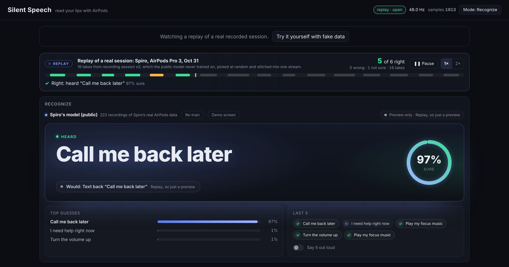
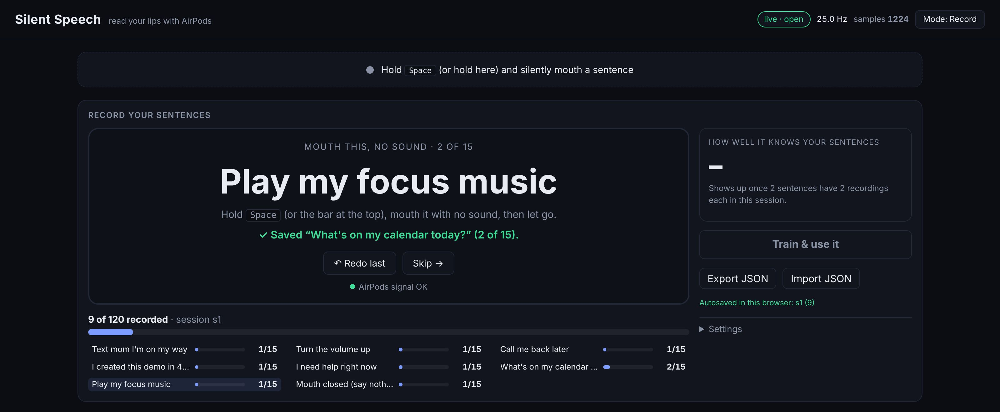
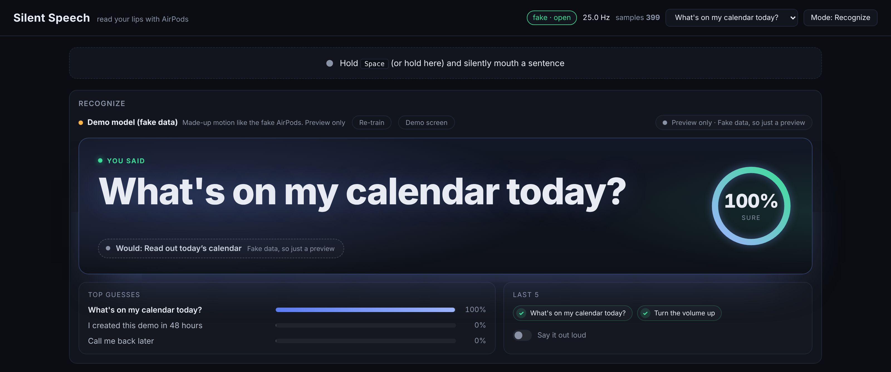
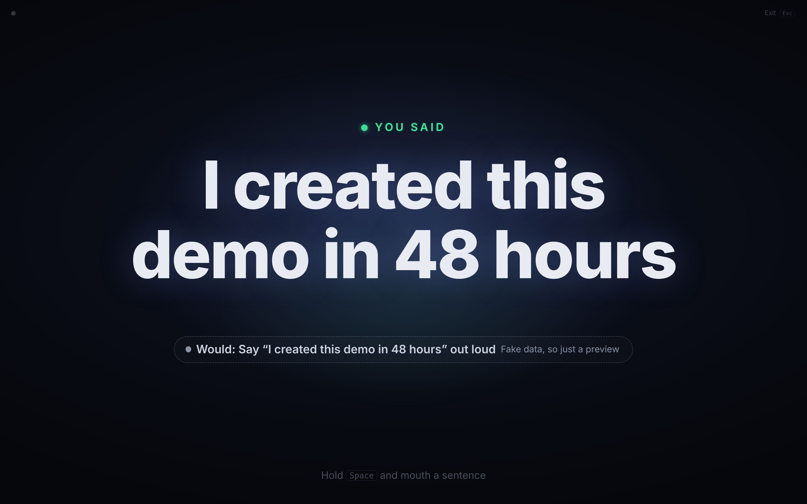
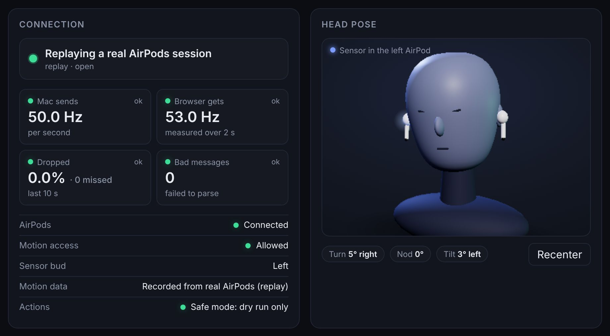

# Using Silent Speech

How to record, recognize and run actions. New here? Start with [Setup](setup.md).

## The screens

The live site replaying one of Spiro's real recording sessions. The model never saw this session while it was trained.

The replay above is what visitors see first on the website. The other screens:

<table>
  <tr>
    <td width="50%" valign="top">
      
       <b>Record.</b> One sentence at a time. Hold Space, mouth it, let go. Progress for every sentence below.
    </td>
    <td width="50%" valign="top">
      
       <b>Recognize.</b> What it heard, how sure it is, and what your Mac would do (shown here with fake data).
    </td>
  </tr>
  <tr>
    <td width="50%" valign="top">
      
       <b>Demo screen.</b> Full screen, only the sentence, for filming. Texts never send from it.
    </td>
    <td width="50%" valign="top">
      
       <b>Connection and head pose.</b> Readings per second, dropped samples, and which AirPod is the sensor.
    </td>
  </tr>
</table>

## Using it

### Record

- The page shows one sentence. Wait until it turns solid white, hold <kbd>Space</kbd> (or the bar at the top), mouth
  it with no sound, then let go. Made a mistake? **Redo last**.
- Sentences come in a shuffled order. The default is **15 takes of each** per session. Your model can run actions once
  every sentence has **at least 5**.
- **"Mouth closed (say nothing)"** is the 8th thing it learns: keep your mouth closed and still while you hold Space.
  No nods, no swallows.
- A **session** is one sitting. When one is done, take the AirPods out and back in and press
  **Start the next session**. More sessions, at different times, make it much better.
- **How well it knows your sentences** (right side) tests itself on your takes as you go, with a small grid of which
  sentences it mixes up.
- Takes are saved in this browser. **Export JSON** after each session as a backup; **Import JSON** brings one back.

### Recognize

- Switch with the **Mode** button at the top right. The model line says what it is using: **Your model** (the only
  one that can run actions), a preview of yours (not every sentence has 5 takes yet), or Spiro's public model.
- Hold <kbd>Space</kbd>, mouth a sentence, let go. The ring shows how sure it is:

  | Shows | When | What may run |
  |---|---|---|
  | **You said** | 70% sure or more, and the model accepts it | Any action, texts included |
  | **Probably** | 50% to 70% | Only harmless ones: volume, music, calendar, the demo line |
  | **Not sure, try again** | Under 50% | Nothing |

- Under the sentence, a chip says what happened, or **Would: …** and the reason it did not run (for example
  "Safe mode: turn on Armed in the Mac app").
- Recorded more takes? Press **Re-train** (the model line says so when it is out of date).
- **Say it out loud** makes the browser speak each sentence it is sure about.

### Armed: what each sentence does

Nothing real happens until you turn on **Armed** in the Mac app. It is off every time the app starts. Then:

| Sentence | What happens on your Mac |
|---|---|
| Text mom I'm on my way | Messages sends "On my way!" to your contact |
| Turn the volume up | Volume up 15% (up to 100%), and unmute |
| Call me back later | Messages sends "Can't talk now, call me back later" to your contact |
| I created this demo in 48 hours | The Mac says the sentence out loud (you can change the words) |
| I need help right now | Alarm sound, a red notice above every window, the Dock icon bounces, and a text "I need help right now" to your contact. It never calls emergency services |
| What's on my calendar today? | Reads today's events and speaks one sentence about them (written by Apple's on device model on macOS 26 with Apple Intelligence, otherwise a plain list) |
| Play my focus music | Your playlist in Music, an Apple Music link, or Spotify. With nothing set: Apple Music's public "Pure Focus" playlist |

Texts have a 30 second cooldown each; other actions 3 seconds. Change the messages, the spoken line and the volume step
in [Make it yours](make-it-yours.md).

### Demo screen

For filming. On the Recognize card, click **Demo screen**: the page goes full screen and shows only the sentence.
Press <kbd>Esc</kbd> to leave.

- **Texts never send from it.** When a text would have gone out, it shows a text bubble marked **Demo: not sent**.
- **"I need help right now"** sounds a short alarm and says **Demo: no text sent**, but only when a real help text would
  have gone out (live, Armed, paired, your own model, every check passed). Otherwise the red alert shows the usual
  **Would: …** line, with no sound.
- **Harmless actions still run** on the Mac (volume, music, calendar, the demo line).
- **It speaks every sentence it shows**, from 50% sure ("Probably" too), so the video has sound. (Not the demo line
  when the Mac is already saying it.)

### Session recorder

With the Mac app connected, the **Session recorder** card records a whole run: motion, your push to talk, what the
model heard and what ran. It prompts you with the sentence to say next, so every take is scored, and exports a replay
file like the one on the live site. It is also a good way to test yourself on sentences you did not pick.

## Tips for accuracy

The short version of [Train it on your mouth](calibration.md):

- **One ear.** Wear one AirPod, or check which one is the sensor. Record and use the same ear.
- **Still "nothing".** For "Mouth closed", keep your mouth closed and still. No nods, no swallows.
- **Clear mouthing.** A bit bigger than normal, the same way every time, head still (rest it against a chair).
- **Generous timing.** Press Space a moment before you start and let go a moment after you finish.
- **Two or more sessions,** at different times. On Spiro's data, one session predicted the next at 92%; four sessions
  at 98.3%.
- **Re-train** after recording more.
